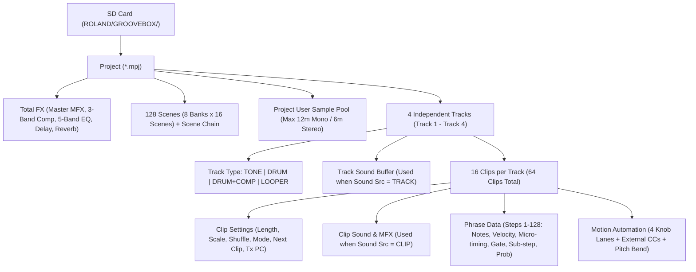
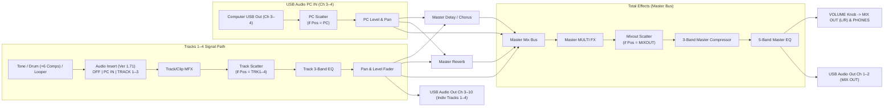

# Roland MC-101 Operational Reference, Architecture & Best Practices

## Sources of Information

This document serves as the operational foundation for building software editors, hardware controller bridges (such as Ableton Push and Zynthian integrations), and performance workflows around the Roland MC-101 Groovebox. It synthesizes and cross-verifies information from:

1. **Roland MC-101 Reference Manual (2019, v1.00)**: Complete hardware panel layout, core sequencing, sound browsing, Looper, Scatter, Total Effects, parameter lists, and audio/MIDI block diagrams.
2. **Roland MC-101 Update Manuals (Ver. 1.02, 1.20, 1.30, 1.50, 1.60, 1.71, 1.80, and 1.81/1.82 release notes)**: All major functional expansions including the Onboard Tone Partial Editor, Undo/Redo, Scene Chain, Clip Chain, Audio Insert, Arpeggiator, Chord Mode, Random Tone Designer, User Sample Editor, SMF/Clip/Pack import/export, and External MIDI Motion recording.
3. **Roland MC-101 MIDI Implementation Chart (Ver. 1.60+)**: Official transmitted and recognized MIDI messages, CC mappings, Program Change rules, and Realtime sync behavior.
4. **[Roland MC-101 Shortcuts, Tips & Tricks](https://sites.google.com/view/rolandmc101/home)**: Community-curated operational database covering undocumented workflow shortcuts, sound/PCM organization, Looper memory management, and MIDI routing tricks.
5. **Hardware Probing & SysEx Research ([`mc101-sysex.md`](mc101-sysex.md))**: Internal memory architecture, Slot 17 working buffer mechanics, and SysEx vs. MIDI performance boundaries.
6. **LinuxMusicians & mc101-pisound Research ([LinuxMusicians Thread #27111](https://linuxmusicians.com/viewtopic.php?t=27111) & [`RowdyVoyeur/mc101-pisound`](https://github.com/RowdyVoyeur/mc101-pisound))**: Empirical methodology for operating the MC-101 in 10-out / 4-in `VENDOR` mode on Linux / Raspberry Pi / Patchbox OS / Zynthian without proprietary drivers, utilizing `alsa_in` / `alsa_out` channel allocation and JACK patching.

---

## 1. System Architecture & Data Hierarchy

The MC-101 is a 4-track, clip-based groovebox powered by Roland's **ZEN-Core** synthesis engine. Understanding its internal data hierarchy is essential when designing external control software.



### 1.1 Projects (`*.mpj`)
- All data for a song is stored in a single **Project** file on the SD card (`ROLAND/GROOVEBOX/PROJECT/`).
- A project encapsulates:
  - **4 Tracks** and their **64 Clips** (16 clips per track).
  - **128 Scenes** (8 banks of 16 scenes) and **Scene Chain** settings.
  - **Project Settings**: `Proj Level` (`0–127`), `MstrTune` (`415.3 Hz–466.2 Hz`), `First Scene` (`1–8`), `Key` (`NONE`, `C`–`B`), `Scale` (`NONE`, `MAJOR`, `MINOR`), `WAV Prv.Lv` (preview volume), `PC IN` settings, and custom Pad LED `COLOR` assignments.
  - **Total Effects** (Master Reverb, Master Chorus/Delay, Master MFX, 3-Band Master Compressor, 5-Band Master EQ) and **Scatter** configurations.
  - **User Samples** imported into the project (Tone/Drum samples and Looper audio).
- **Volatility Warning**: Edits made in RAM are lost when switching projects or powering down unless explicitly saved via `[PROJECT]` $\rightarrow$ `WRITE` (or shortcut `[SHIFT] + [TEMPO]`). Projects can be write-protected via `[PROJECT]` $\rightarrow$ `LOCK`.

### 1.2 The Four Track Types
Each of the 4 tracks (`TRACK SEL [1]–[4]`) can be assigned to one of four engine types. To change an existing track's type, you must delete the track (`[SHIFT] + [PROJECT] + [TRACK SEL 1–4]`) and create a new one:

| Track Type | Engine Capabilities | Polyphony / Constraints |
|---|---|---|
| **TONE** | 4-Partial ZEN-Core synthesizer (`PCM`, `VA`, `PCM-Sync`, `SuperSAW`, `Noise`) or pitched User Sample playback. Includes 1 Track/Clip MFX and 3-band Track EQ. | Shares the global 128-voice (partial) pool. Up to 4 TONE tracks per project. |
| **DRUM** | 16-pad drum kit (88 MIDI keys addressable). Each pad supports PCM presets or User Samples, independent Pitch/Filter/Env offsets, Mute Groups (`1–31`), and a dedicated 3-band `PAD EQ`. Includes 1 Kit MFX and 3-band Track EQ. | Max 16 voices per Drum track. Up to 4 DRUM tracks per project. |
| **DRUM + COMP** | Identical to `DRUM`, but adds **6 independent compressors** (`DRUM COMP 1–6`). Any pad can be routed (`Out Assign`) to `DRY`, `MFX`, or `COMP 1–6`. | **Maximum 1 `DRUM + COMP` track per project.** |
| **LOOPER** | Real-time audio recorder and sample player with time-stretching (`TYPE1` Melodic, `TYPE2` Rhythmic) and pitch-shifting. Includes 1 Track MFX and 3-band Track EQ. | Max ~60 seconds total Looper recording time per project (1–8 measures per clip). |

### 1.3 Track `Sound Src` (`TRACK` vs. `CLIP`) — Critical Concept
For `TONE`, `DRUM`, and `DRUM + COMP` tracks, the `Sound Src` setting (`[SHIFT] + [TRACK SEL 1–4]` $\rightarrow$ `GEN` tab) fundamentally alters how sounds are managed:
- **`Sound Src = TRACK` (Default)**: All 16 clips on the track share a single Tone or Drum Kit (and MFX). Switching clips only changes the MIDI phrase and motion automation, guaranteeing zero audio gap or effect tail cutoff during clip transitions.
- **`Sound Src = CLIP`**: Every clip (`1–16`) on the track stores its own independent Tone or Drum Kit and its own MFX.
  - *Gotcha*: Switching `Sound Src` from `TRACK` to `CLIP` initializes the clip sounds. Use `[SHIFT] + [FX]` $\rightarrow$ `TRK TO CLIP SND` to copy the track's current sound into a clip.
  - *SysEx Note*: Regardless of whether `Sound Src` is set to `TRACK` or `CLIP`, the currently active sound playing on a track is always mirrored into the track's working buffer (**Slot 17**, see [`mc101-sysex.md`](mc101-sysex.md)).

---

## 2. Audio Signal Flow & USB Routing Architecture

Based on the Reference Manual Block Diagram (p. 89) and Firmware Ver. 1.71 (`Audio Insert` and `PC IN` send additions), the internal audio routing operates as follows:



### 2.1 Audio Insert Function (Added in Ver. 1.71)
Located in `[SHIFT] + [TRACK SEL 1–4]` $\rightarrow$ `GEN` tab $\rightarrow$ `Insert`:
- Allows routing external USB audio (`PC IN L/R`, `PC IN L`, `PC IN R`) or an internal track (`TRACK 1–3`) **directly before the target track's MFX**.
- **Rules & Constraints**:
  - You can only insert a track whose number is **lower** than the target track (e.g., Track 1 can be inserted into Track 2, 3, or 4; nothing can be inserted into Track 1).
  - This enables **chaining multiple Track MFX in series** (e.g., Track 1 $\rightarrow$ Track 2 MFX $\rightarrow$ Track 3 MFX) or processing external USB audio through a track's MFX, 3-band EQ, and fader.
  - Lower the physical level fader of the source track so its dry pre-insert signal is not doubled in the Master Mix.

### 2.2 USB Audio & Driver Modes (`VENDOR` vs. `GENERIC`)
Configured in `[SHIFT] + [FILTER]` (UTILITY) $\rightarrow$ `SYSTEM` $\rightarrow$ `CTRL` tab $\rightarrow$ `USB Drv`:
1. **`GENERIC` (Class-Compliant Mode — Added in Ver. 1.60)**:
   - Plug-and-play without drivers on iOS, Android, Linux (Zynthian), macOS, and Windows.
   - Provides **Stereo USB Audio In/Out (2-in / 2-out)** and **USB MIDI In/Out**.
2. **`VENDOR` (Dedicated Driver / AIRA Link Mode)**:
   - Officially intended for Roland drivers on macOS/Windows or connection to an AIRA MX-1 mixer.
   - Under Linux, operates natively via standard ALSA USB audio drivers without proprietary software (see Section 2.3).
   - Provides **10-Channel USB Audio Output** (`Ch 1–2`: Master Mix Out; `Ch 3–4`: Track 1; `Ch 5–6`: Track 2; `Ch 7–8`: Track 3; `Ch 9–10`: Track 4) and **4-Channel USB Audio Input** (`Ch 1–2`: Mix Return; `Ch 3–4`: `PC IN`).
- **USB Audio Mix Settings**:
  - `USBMix` (`PRE T-FX` vs. `POST T-FX`): Determines whether USB Mix In (Ch 1–2) is summed before or after Total Effects.
  - `D.USB Mixout` (`OFF`, `1–127`, Ver. 1.60): When set to `OFF`, the hardware `[VOLUME]` knob controls the USB MIX OUT level. When set to `1–127`, USB MIX OUT is fixed at that level independent of the `[VOLUME]` knob.
  - `MetPos` (`MIXOUT`, `PRE T-FX`, `POST T-FX`, Ver. 1.71): Controls whether the metronome click is routed only to analog `MIXOUT` (not sent over USB) or included in USB audio.

### 2.3 Linux & Raspberry Pi Multi-Channel USB Architecture (`VENDOR` Mode without Drivers)

While Roland officially states that `VENDOR` mode requires proprietary drivers (only released for Windows and macOS), the standard Linux ALSA kernel stack can drive the MC-101 in full `VENDOR` multi-track mode on a **Raspberry Pi 4 running Patchbox OS or Zynthian OS** without installing any custom kernel drivers.

#### The Mandatory Channel Allocation Rule (Avoiding Initialization Errors)
> [!IMPORTANT]
> **Exact Channel Count Requirement:**
> When opening the MC-101 in `VENDOR` mode under Linux, the hardware descriptor advertises an inflexible channel mask:
> - **10 Output Channels (Capture into Host)**: Attempting to open fewer than 10 channels will cause ALSA initialization to fail with buffer/device channel errors. You must explicitly request **`-c 10`**.
> - **4 Input Channels (Playback from Host into MC-101)**: Attempting to open fewer than 4 channels will similarly fail. You must explicitly request **`-c 4`**.

#### Launching the Dual ALSA-JACK Bridge Daemons
Use `alsa_in` and `alsa_out` to bridge the MC-101's hardware audio streams into the JACK audio graph alongside your primary soundcard (e.g., Pisound):

```bash
# Bridge 10 audio channels FROM MC-101 INTO JACK (Capture)
alsa_in -j "MC101_in" -d hw:MC101,DEV=0 -r 44100 -p 64 -n 4 -c 10 &

# Bridge 4 audio channels FROM JACK INTO MC-101 (Playback)
alsa_out -j "MC101_out" -d hw:MC101,DEV=0 -r 44100 -p 64 -n 4 -c 4 &
```

#### Complete Channel Topography

| JACK Port Name | Hardware Direction | MC-101 Channel | Signal Description | Control & Routing Behavior |
|---|---|---|---|---|
| `MC101_in:capture_1` / `_2` | MC-101 $\rightarrow$ Host | **Ch 1 + 2** | **Master Mix Out (L/R)** | Summed stereo mix post-Total Effects (Master MFX, Comp, EQ) |
| `MC101_in:capture_3` / `_4` | MC-101 $\rightarrow$ Host | **Ch 3 + 4** | **Track 1 Direct Out (L/R)** | Isolated audio from Track 1 post-Track MFX/EQ, pre-Master FX |
| `MC101_in:capture_5` / `_6` | MC-101 $\rightarrow$ Host | **Ch 5 + 6** | **Track 2 Direct Out (L/R)** | Isolated audio from Track 2 post-Track MFX/EQ, pre-Master FX |
| `MC101_in:capture_7` / `_8` | MC-101 $\rightarrow$ Host | **Ch 7 + 8** | **Track 3 Direct Out (L/R)** | Isolated audio from Track 3 post-Track MFX/EQ, pre-Master FX |
| `MC101_in:capture_9` / `_10`| MC-101 $\rightarrow$ Host | **Ch 9 + 10**| **Track 4 Direct Out (L/R)** | Isolated audio from Track 4 post-Track MFX/EQ, pre-Master FX |
| `MC101_out:playback_1` / `_2`| Host $\rightarrow$ MC-101 | **Ch 1 + 2** | **Master In (Mix Return)** | **Bypasses internal controls**. Always active and routed directly into the master bus |
| `MC101_out:playback_3` / `_4`| Host $\rightarrow$ MC-101 | **Ch 3 + 4** | **PC IN (Audio Insert)** | **Fully controllable**. Selectable L/R channels, route into `Audio Insert` on Tracks 1–4, and process with MFX |

#### Practical JACK Routing Examples (`jack_connect`)

```bash
# 1. Route MC-101 Master Out directly to physical monitors/headphones (e.g., Pisound / System Out)
jack_connect MC101_in:capture_1 system:playback_1
jack_connect MC101_in:capture_2 system:playback_2

# 2. Route external live audio (e.g. Pisound Line In or Zynthian synth) into MC-101 PC IN (Channels 3 & 4)
# This allows processing external audio through MC-101 Track MFX via the Audio Insert feature!
jack_connect system:capture_1 MC101_out:playback_3
jack_connect system:capture_2 MC101_out:playback_4

# 3. Route isolated MC-101 Track 1 audio into a Zynthian Effect Chain (e.g., Guitarix or MOD-UI)
jack_connect MC101_in:capture_3 effect_processor:input_1
jack_connect MC101_in:capture_4 effect_processor:input_2
```

---

## 3. Front Panel Controls, Modes & Knob Architecture

### 3.1 Control Knobs `[C1]`–`[C4]` & `KnobTrk` Modes
The four rotary encoders `[C1]`–`[C4]` work in tandem with the `[SOUND]`, `[FILTER]`, `[MOD]`, and `[FX]` buttons:

| `KnobTrk` Setting | How `[C1]`–`[C4]` Behave | Best Used For |
|---|---|---|
| **`MULTI`** (Default) | Pressing `[SOUND]`, `[FILTER]`, `[MOD]`, or `[FX]` assigns `[C1]`–`[C4]` to control that category across **Tracks 1, 2, 3, and 4** respectively. | Mixing and multi-track live performance sweeps. |
| **`SINGLE`** (Ver. 1.30+) | `[C1]` controls `SOUND`, `[C2]` controls `FILTER`, `[C3]` controls `MOD`, and `[C4]` controls `FX` simultaneously for the **currently selected track**. | Deep sound design and single-track performance. |

- **Shortcut to Toggle `KnobTrk`**: Press `[SOUND] + [FILTER] + [MOD] + [FX]` simultaneously.
- **`Knob Mode` (`DIRECT` vs. `CATCH`)**: Set in `UTILITY` $\rightarrow$ `SYSTEM` $\rightarrow$ `CTRL`. `DIRECT` jumps immediately when turned; `CATCH` waits until the physical knob crosses the stored parameter value.
- **Viewing Knob Values Non-Destructively**: Hold `[SHIFT]` and turn `[C1]`–`[C4]` to inspect the current value without modifying it.

### 3.2 Custom Knob Assignments (`KNOB ASSIGN`)
Hold `[SOUND]`, `[FILTER]`, `[MOD]`, or `[FX]` for **>1 second** and turn `[C1]`–`[C4]` to assign any of the following targets per track (or per clip if `Sound Src = CLIP`):

- **Common to All Track Types**: `No Assign`, `Level`, `Pan`, `Delay Send`, `Reverb Send`, `SYS-Ctrl 1–4`.
- **Tone & Drum Tracks**: `Coarse Tune`, `Fine Tune`, `Cutoff`, `Resonance`, `Attack`, `Decay`, `Release`.
- **Tone Tracks Only**: `Portamento`, `Porta Time`, `Vib Rate`, `Vib Depth`, `Vib Delay`, `Oct Shift`, `Pitch Bend`.
- **Looper Tracks Only**: `Pitch Chrom` (`±24` semitones), `Pitch Fine`, `Pitch Shift` (`0–400%`), `Reverse`.

> [!TIP]
> **Power Feature — `SYS-Ctrl 1–4`**: Assigning a knob to `SYS-Ctrl 1–4` links it to the ZEN-Core **Matrix Control** (`SRC = SYS-CTRL1..4`) and **MFX Control** (`Src1–4 = SYS-CTRL1..4`). Because Matrix Control has 4 patch slots (each with up to 4 destinations in SysEx), a single physical knob or external CC (`CC 80–83`) can modulate up to 16 synthesis and MFX parameters simultaneously with independent positive or negative depths!

---

## 4. Pad Modes (`[CLIP]`, `[SEQ]`, `[NOTE]`, `[SCATTER]`)

The 16 illuminated velocity-sensitive pads switch function according to the active **PAD MODE** button:

### 4.1 `CLIP` Mode
- **Launch Clips**: Pads `1–16` launch Clips `1–16` on the currently selected track.
- **Edit Clip Without Launching It (Ver. 1.30+)**: Hold `[SHIFT]` and press Pad `1–16` (or turn `[VALUE]`) to move the `EDIT` cursor to another clip while the current `PLAY` clip continues playing.
- **Scenes & Scene Banks (Ver. 1.50+)**:
  - **Recall Scene**: Hold `[CLIP]` and press Pad `1–8` to launch a scene in the current bank.
  - **Store Scene**: Hold `[CLIP]` and **long-press** Pad `1–8`.
  - **Delete Scene**: Hold `[SHIFT] + [PROJECT]` and press Pad `1–8` while in Scene view.
  - **Switch Scene Banks (128 Scenes Total)**: Hold `[CLIP]` and press Pad `9–16` to select Banks `1–8`. Press the same Pad `9–16` a second time to toggle into Banks `9–16` (8 banks $\times$ 16 scenes = 128 scenes).
  - **Lock Scene Screen**: Press `[CLIP] + [SEQ]` (or press `[SHIFT]` while holding `[CLIP]`) to keep the Scene screen latched so Pads `1–16` directly trigger scenes.

### 4.2 `SEQ` Mode (16-Step Sequencer)
- Pads `1–16` represent the 16 steps of the current measure. Use `MEASURE [<] [>]` to navigate up to 8 measures (128 steps max).
- **Step Recording (Tone Track)**:
  - Press a Pad `1–16` in `SEQ` mode to open `STEP EDIT`, then press `[NOTE]` to enter notes on that step using the keyboard pads.
  - **Auto-Advance Step Input**: In `SEQ` mode, hold `[REC]` and press the starting step pad, then press `[NOTE]`. Each note or chord you play automatically advances the step counter by 1. Press Pad 4 (`[REST/TIE]`) to insert a rest, or hold a note pad and press `[REST/TIE]` to insert a tie.
- **TR-REC Drum Programming**:
  - In `NOTE` mode, hit the drum pad you want to sequence to select it, then switch to `SEQ` mode and toggle steps `1–16` on/off.
  - **Weak Beats Shortcut**: Hold `[TRACK SEL]` of the drum track and press a step pad in `SEQ` mode to input a lower-velocity grace/ghost note.
  - **Quick Sub-Step / Flam**: Hold `[SEQ]` and press a step pad `1–16` on a drum track to immediately enter a sub-step.
  - **Quick Tie**: Hold `[EXIT]` and press a step pad in `SEQ` mode on a drum track.

### 4.3 `NOTE` Mode (Keyboard, Drum Pads, Chords & Arpeggiator)
- **Tone Track Keyboard**:
  - Pads act as a 13-key chromatic keyboard (`C` to `C`) with Pad 1 (`[OCT-]`), Pad 8 (`[OCT+]`), and Pad 4 (`[REST/TIE]`).
  - **Scale Performance Mode (Ver. 1.20+)**: In `[SHIFT] + [NOTE]`, set `SCALE` to any of **34 musical scales** (Major, Minor, Dorian, Phrygian, Lydian, Mixolydian, Locrian, Pentatonics, Blues, Harmonic/Melodic Minor, Whole Tone, Diminished, Arabic, Gypsy, Japanese Hirajoshi/Miyakobushi/Ryukyu, Indian Thaats, etc.) or **Guitar / Violin fretboard layout**. When a non-Chromatic scale is active, hold `[NOTE]` and press `[OCT-]`/`[OCT+]` to shift octaves, or hold `[NOTE]` and press a note pad to transpose the key.
- **Chord Mode & Chord Designer (Ver. 1.50+ / Ver. 1.71+)**:
  - Press `[NOTE]` a second time while in `NOTE` mode (`[NOTE]` LED blinks) to enter **Chord Mode** (up to 13 custom chords stored on Pads 2, 3, 5, 6, 7, and 9–16).
  - Open **Chord Designer** via `[SHIFT] + [FILTER]` while in Chord Mode. Set `KEY`, `SCALE`, `ROOT`, and `SPREAD` (voicing), or use `WRITE ALL TYP1` (parallel chromatic chords across all pads) or `WRITE ALL TYP2` (diatonic scale chords across all pads).
- **Arpeggiator (Ver. 1.60+)**:
  - Hold `[NOTE]` (or press `[EXIT] + [NOTE]`) in Note or Chord mode to toggle the Arpeggiator.
  - Configure in `[SHIFT] + [NOTE]` (`ARP` tab):
    - `MOTIF`: `UP`, `DOWN`, `UP&DOWN`, `RANDOM`, `NOTE ORDER` (remembers up to 128 notes), `GLISSANDO`, `CHORD`, `AUTO1` (low note priority), `AUTO2` (high note priority), `PHRASE`.
    - `VARIATION`: `1/4`, `1/8`, `1/4T`, `1/16`, `1/8T`, `1/32`, and `x2` double-strike variations.
    - `OCTAVE`: `-3` to `+3`.
    - `HOLD`: `ON`, `OFF`.
- **Drum Track Pad Muting**:
  - **Track Pad Mute**: In `NOTE` mode, hold `[TRACK SEL 1–4]` and press drum pads `1–16` to mute/unmute individual drum instruments across the entire track (persists when switching clips).
  - **Clip Pad Mute**: In `NOTE` mode, hold `[NOTE]` and press drum pads `1–16` to mute/unmute drum instruments for the **current clip only**.

### 4.4 `SCATTER` Mode
- **Pad Triggering**: Pressing Pads `1–16` applies 16 distinct real-time glitch/rhythm/DSP effects (`Reverse`, `Retrig 1–32`, `RetrigGlide`, `Hold`, `Chromatic Pitch`, `Pitch Bend/Glide`, `Pan/Pan Glide`, `Level/Level Glide`, `Mask`, `Mute`, `Grain 1–16` or `Random 1–8`, `Attack/Decay`, `MFX 1/2 Send`).
- **Step Sequenced Scatter (Ver. 1.80+)**: Press `[SCATTER]` a second time while in Scatter mode (`[SCATTER]` blinks) to run the 16-step Scatter sequence (`MOMENTARY` while held, or `ALTERNATE` latch).
- **Scatter Quantize & Per-Pad Insert Position (Ver. 1.60 / 1.71)**:
  - Each Scatter pad can dynamically switch the Scatter insert point (`POS`: `OFF` [follow global], `PC`, `TRK1–4`, `MIXOUT`).
  - `Quantize` (`OFF`, `1–16` steps) quantizes both the trigger onset and duration of Scatter pads for tight live performance.

---

## 5. Sound Engines & Onboard Editing Capabilities

### 5.1 Onboard Tone Partial Editor (Added in Ver. 1.80)
Accessible via `[SHIFT] + [SOUND]` $\rightarrow$ `PARTIAL`:
- **Partial Mute Toggles**: Hold `[SHIFT]` and press `[SOUND]` (Partial 1), `[FILTER]` (Partial 2), `[MOD]` (Partial 3), or `[FX]` (Partial 4) to toggle each partial On/Off.
- **Editable Sections on Hardware**:
  1. **`COM` (Common)**: `OCT` (`±3`), `M/P` (`MONO`/`POLY`), `PRT` (Portamento `OFF`/`ON`), `TIM` (`0–1023`), `ANL` (Analog Feel `0–127`), `CRS` (`±48` semitones).
  2. **`OSC 1–4`**: `OSC` (`PCM`, `VA`, `PCM-Sync`, `SuperSAW`, `Noise`), `GRP` (`INT`, `SAMP`), `BNK` (`A`, `B`, `C`), `WAV` (PCM wave number / Sample / VA waveform: `SAW`, `SQR`, `TRI`, `SIN`, `RAMP`, `JUNO`, `TRI2`, `TRI3`, `SIN2`), `PW` (`0–127`), `PWM` (`±63`, driven by LFO2), `DET` (SuperSAW detune `0–127`), `SW` (`OFF`/`ON`), `CRS` (`±48`), `FIN` (`±50` cents), `LEV` (`0–127`).
  3. **`OSC MOD 1-2 / 3-4` (Structure)**: `STR` (`OFF`, `SYNC`, `RING`, `XMOD`, `XMOD2`), `LV1/3` (`0–127`), `LV2/4` (`0–127`), `RNG` (`0–127`), `MOD` (`0–10800` cents for XMOD; `0–127` for XMOD2).
  4. **`FILTER`**: `TVF/VCF`, `TYP` (TVF: `OFF`, `LPF`, `BPF`, `HPF`, `PKG`, `LPF2`, `LPF3`; VCF: `FLAT`, `TYPE-JP`, `TYPE-M`, `TYPE-P`), `SLP` (`-12`, `-18`, `-24` dB/Oct), `CUT` (`0–1023`), `RES` (`0–1023`), `ENV` (`±63`), `KF` (`-200` to `+200`), `HPF` (`0–1023`, active when `VCF` is selected).
  5. **`ENV FILTER`, `ENV AMP`, `ENV PITCH` & `ENV COM`**: `T1A` (Attack `0–1023`), `T3D` (Decay `0–1023`), `L3S` (Sustain `0–1023` or `±511` for Pitch), `T4R` (Release `0–1023`), Pitch `DEP` (`±100` for VA, limited to `±63` for non-VA), `ADS` (`ADSR MODE` toggle).
  6. **`LFO 1/2`**: `WAV` (`SIN`, `TRI`, `SAW-UP`, `SAW-DW`, `SQR`, `RND`, `TRP`, `S&H`, `CHS`, `VSIN`, `STEP`), `SYN` (`OFF`/`ON`), `RAT` (`0–1023` or `1/64T–4`), `FAD` (`0–1023`), `FLT` (`±100`), `PIT` (`±100` for VA, `±63` for non-VA), `AMP` (`±100`), `PAN` (`±63`).
  7. **`EQ`**: `SW` (`OFF`/`ON`), `LO`/`MID`/`HI` Gain (`±24` dB), `LO`/`MID`/`HI` Freq (`20–16000` Hz), `Q` (`0.5–16.0`).
  8. **`MATRIX 1–4`**: `SRC`, `TO` (Destination), `DEP` (`±63`).
  9. **`VELOCITY SENS`**: `LVL` (`±100`), `CUT` (`±100`), `DEP` (`±100`), `T4R` (`±100`).

### 5.2 Random Tone Designer (Added in Ver. 1.60)
Select a Tone track $\rightarrow$ press `[VALUE]` $\rightarrow$ select `RANDOM` $\rightarrow$ choose one of **12 generative algorithms**:
- `POLY`, `MONO`, `PAD`, `MOD`, `ANALOG`, `A.MONO`, `A.PAD`, `DRUM`, `KICK`, `SNARE`, `CYMBAL`, `C.BELL`.

### 5.3 User Sample Edit (Added in Ver. 1.50)
When a WAV sample is loaded into a Tone track or Drum pad (`[SHIFT] + [SOUND]` or `[SHIFT] + [PAD]` in Note mode $\rightarrow$ `SAMPLE EDIT`):
- `Mode`: `FWD`, `ONESHOT`, `REV`, `REV-ONE`.
- `Start`, `Loop`, `End`: `0` to `8,388,607` samples.
- `OrgKey`: `C-1` to `G9`.
- `Fine`: `-50.0` to `+50.0` cents.
- `Gain`: `0 dB`, `+6 dB`, `+12 dB`.
- `Level`: `0–127`.

---

## 6. Sequencer, Motion Automation & Chaining

### 6.1 Step Parameters & Micro-Editing
In `SEQ` mode, pressing a lit step pad (Tone track) or `[SHIFT] + [PAD]` (Drum track) opens `STEP EDIT`:

| Knob | Tone Track `STEP EDIT` | Drum Track `STEP EDIT` | Motion Page (Press `[VALUE]` in `STEP EDIT`) |
|---|---|---|---|
| **`[C1]`** | `NOTE` (Pitch `C-1`–`G9`) | `VEL` (`1–127`) | `SND` (`OFF`, `0–127` for `[SOUND]` knob) |
| **`[C2]`** | `VEL` (`1–127`) | `STA` (Micro-timing start offset) | `FLT` (`OFF`, `0–127` for `[FILTER]` knob) |
| **`[C3]`** | `STA` (Micro-timing start offset) | `MTE` (Mute probability `0–100%`) | `MOD` (`OFF`, `0–127` for `[MOD]` knob) |
| **`[C4]`** | `LEN` (Note length / `TIE`) | `SUB` (`OFF`, `1/2`, `1/3`, `1/4`, `FLAM`) | `FX` (`OFF`, `0–127` for `[FX]` knob) |

- **Tone Track Second Page (Press the same step pad a second time, Ver. 1.60+)**: `[C2]` edits `SUB` (`OFF`, `1/2`, `1/3`, `1/4`, `FLAM`).
- **Drum Track Second Page (Press the same step pad a second time, Ver. 1.60+)**: `[C1]` edits `END` (`0–99`, `TIE` note gate length).
- **Fine Value Adjustment**: Hold the button below a knob (`[SOUND]`, `[FILTER]`, `[MOD]`, `[FX]`) and turn `[VALUE]` for 1-unit precision.
- **Note Utility (`[SHIFT] + [FILTER]` inside `STEP EDIT`, Ver. 1.50+)**:
  - `SHIFT NOTE UP` / `SHIFT NOTE DOWN` (±1 semitone across the entire clip, Tone track only).
  - `SHIFT NOTE LEFT` / `SHIFT NOTE RIGHT` (rotates all steps left/right by 1 step).
  - `QUANTIZE` (destructively quantizes all notes in the clip).

### 6.2 Motion Automation & External MIDI Motion (Ver. 1.80+)
- **Internal Knob Motion**: Records movements of `[SOUND]`, `[FILTER]`, `[MOD]`, and `[FX]` per step.
- **External MIDI CC Motion (Ver. 1.80+)**:
  - Enable `Rx ModWheel` (`CC 1`), `Rx BrthCtrl` (`CC 2`), `Rx FootCtrl` (`CC 4`), `Rx Volume` (`CC 7`), `Rx Pan` (`CC 10`), `Rx Exp` (`CC 11`), `Rx Hold-1` (`CC 64`), `Rx RevSend` (`CC 91`), `Rx ChoDlySend` (`CC 93`), `Rx ChPress`, and `Rx P.Bend` in `[SHIFT] + [TRACK SEL 1–4]` $\rightarrow$ `MIDI` tab.
  - **Constraint**: Each clip can record **at most 4 external MIDI CC/Aftertouch parameters in addition to Pitch Bend**. Any 5th CC parameter is ignored during recording.
- **Motion Designer (`[SHIFT] + [MOD]` $\rightarrow$ `MOTION DESIGNER`)**:
  - Generates mathematical curves across steps: `FORM TYPE` (`SIN`, `COS`, `TRI`, `SAW`, `SQR`, `TRP`, `ARC`, `RND`), `STEP LEN`, `MIN VALUE`, `MAX VALUE`, `DEST KNOB`.

---

## 7. Complete MIDI Implementation & External Control

### 7.1 Channel Architecture
1. **Track Channels (`Track1–4 Ch`, Default `CH 1–4`)**: Receives notes, pitch bend, aftertouch, and CCs for each track; receives Program Change `0–15` to switch Clips `1–16`.
2. **Auto Channel (`MIDI Rx Auto Channel`, Ver. 1.30+)**: Redirects incoming MIDI on the designated channel to whichever track (`1–4`) is currently selected on the front panel. **Required** if you want an external MIDI keyboard to trigger the MC-101's internal **Arpeggiator** (Ver. 1.80+).
3. **Control Channel (`Control Channel`, Ver. 1.20+)**:
   - Receives **Program Change `0–127`** to switch **Scenes `1-01` through `8-16`** (requires `Control Rx = ON` in System MIDI Settings).
   - Receives **MIDI Notes `60–75` (`C4–D#5`)** to trigger **Scatter Pads `1–16`** (requires `RX Scatter = ON` in System MIDI Settings).

### 7.2 Control Change (CC) Reference Table

| CC # | Parameter | TX | RX | Notes / Configuration |
|---|---|---|---|---|
| `CC 1` | Modulation Wheel | No | Yes | Recordable as Motion if `Rx ModWheel = ON` |
| `CC 2` | Breath Controller | No | Yes | Recordable as Motion if `Rx BrthCtrl = ON` |
| `CC 4` | Foot Controller | No | Yes | Recordable as Motion if `Rx FootCtrl = ON` |
| `CC 5` | Portamento Time | No | Yes | — |
| `CC 7` | Track Volume | No | Yes | Recordable as Motion if `Rx Volume = ON` |
| `CC 10` | Track Panpot | No | Yes | Recordable as Motion if `Rx Pan = ON` |
| `CC 11` | Expression | No | Yes | Recordable as Motion if `Rx Exp = ON` |
| `CC 64` | Hold 1 (Damper / Sustain) | No | Yes | Recordable as Motion if `Rx Hold-1 = ON` |
| `CC 65` | Portamento Switch | No | Yes | `0–63`: OFF, `64–127`: ON |
| `CC 66` | Sostenuto | No | Yes | — |
| `CC 67` | Soft Pedal | No | Yes | — |
| `CC 68` | Legato Foot Switch | No | Yes | — |
| `CC 71` | Filter Resonance Offset | No | Yes | Centred at `64` |
| `CC 72` | TVA Release Time Offset | No | Yes | Centred at `64` |
| `CC 73` | TVA Attack Time Offset | No | Yes | Centred at `64` |
| `CC 74` | Filter Cutoff Offset | No | Yes | Centred at `64` |
| `CC 75` | TVA Decay Time Offset | No | Yes | Centred at `64` |
| `CC 76` | Vibrato Rate | No | Yes | Centred at `64` |
| `CC 77` | Vibrato Depth | No | Yes | Centred at `64` |
| `CC 78` | Vibrato Delay | No | Yes | Centred at `64` |
| **`CC 80`** | **`[FILTER]` Knob (C2)** | **Yes** | **Yes** | TX CC configurable (`CC 0–119`) per track (Ver. 1.30+) |
| **`CC 81`** | **`[MOD]` Knob (C3)** | **Yes** | **Yes** | TX CC configurable (`CC 0–119`) per track (Ver. 1.30+) |
| **`CC 82`** | **`[FX]` Knob (C4)** | **Yes** | **Yes** | TX CC configurable (`CC 0–119`) per track (Ver. 1.30+) |
| **`CC 83`** | **`[SOUND]` Knob (C1)** | **Yes** | **Yes** | Fixed at `CC 83` |
| `CC 84` | Portamento Control | No | Yes | Source note number |
| `CC 91` | Reverb Send Level | No | Yes | Recordable as Motion if `Rx RevSend = ON` |
| `CC 92` / `93` | Chorus / Delay Send Level | No | Yes | Chart lists `CC 92`; Track MIDI Motion lists `CC 93` |

### 7.3 Pitch Bend, Aftertouch & Channel Mode Messages

| Message / Controller | Status / CC | TX | RX | Operational Behavior |
|---|---|---|---|---|
| **Pitch Bend** | `0xEn` | No | **Yes** | Full pitch wheel deflection mapped to active Tone / Drum partials |
| **Channel Aftertouch** | `0xDn` | No | **Yes** | Monophonic pressure routed to filter cutoff, vibrato, or volume |
| **Polyphonic Aftertouch** | `0xAn` | No | **Yes** | Key-specific pressure mapped per note in compatible ZEN-Core tones |
| **All Sound Off** | `CC 120` | No | **Yes** | Immediately mutes all sound generators and cuts envelope tails |
| **Reset All Controllers** | `CC 121` | No | **Yes** | Resets Modulation, Pitch Bend, Expression, and Pedals to defaults |
| **All Notes Off** | `CC 123` | No | **Yes** | Sends Note-Off to all sounding voices (preserves natural release tails) |
| **Omni Mode Off / On** | `CC 124` / `125` | No | **Yes** | Switches channel recognition modes (Default: Mode 3 Omni Off, Poly) |
| **Mono Mode / Poly Mode** | `CC 126` / `127` | No | **Yes** | Sets mono voice allocation or polyphonic voice allocation |

### 7.4 System Real-Time & Clock Synchronization

| Real-Time Message | Status Byte | TX | RX | Operational Details |
|---|---|---|---|---|
| **Timing Clock** | `0xF8` | **Yes** | **Yes** | 24 PPQN master sync. Transmits clock if `Sync Out = ON`; follows clock if `Sync Mode = SLAVE` or `AUTO` |
| **Start** | `0xFA` | **Yes** | **Yes** | Starts playback from measure 1 of the active scene |
| **Continue** | `0xFB` | No | **Yes** | Resumes playback from current playhead position without restarting measure 1 |
| **Stop** | `0xFC` | **Yes** | **Yes** | Stops playback and sequencer clocks |

### 7.5 Default 16 Drum Pad MIDI Note Layout (Reference: `rolandmc101.top/midi`)

When controlling an MC-101 **DRUM track** from external pad controllers (such as Ableton Push 1 or Korg nanoKONTROL), the 16 physical drum pads correspond to the following MIDI note numbers by default:

```
+---------------------------------------------------------------------------------------------------+
| Upper Row (Pads 1–8):   [C#1 / 37] [D#1 / 39] [F#1 / 42] [A#1 / 46] [C#2 / 49] [D#2 / 51] [F#2 / 54] [G#2 / 56] |
| Lower Row (Pads 9–16):  [C1  / 36] [D1  / 38] [F1  / 41] [A1  / 45] [C2  / 48] [D3  / 62] [D#3 / 63] [E3  / 64] |
+---------------------------------------------------------------------------------------------------+
```

- **Pads 9 & 1**: Bass Drum / Kick (`C1` / Note `36`) & Side Stick (`C#1` / Note `37`)
- **Pads 10 & 2**: Acoustic Snare (`D1` / Note `38`) & Hand Clap (`D#1` / Note `39`)
- **Pads 11 & 3**: Low Floor Tom (`F1` / Note `41`) & Closed Hi-Hat (`F#1` / Note `42`)
- **Pads 12 & 4**: Low-Mid Tom (`A1` / Note `45`) & Open Hi-Hat (`A#1` / Note `46`)
- **Pads 13 & 5**: Low Tom (`C2` / Note `48`) & Crash Cymbal 1 (`C#2` / Note `49`)
- **Pad 6**: Ride Cymbal 1 (`D#2` / Note `51`)
- **Pad 7**: Ride Bell (`F#2` / Note `54`)
- **Pad 8**: Tambourine (`G#2` / Note `56`)
- **Pads 14–16**: Extended Percussion / User Samples (`D3` / Note `62`, `D#3` / Note `63`, `E3` / Note `64`)

### 7.6 System MIDI Configuration Checklist (`[SHIFT] + [FILTER]` $\rightarrow$ `SYSTEM` $\rightarrow$ `MIDI`)

To ensure external controllers and sequencers can operate the MC-101 properly, verify the following system menu settings:

| Parameter | Recommended Setting | Purpose / Impact |
|---|---|---|
| **`Control Rx`** | **`ON`** | **Mandatory** for switching Scenes via Program Change `0–127` on the Control Channel |
| **`Control Channel`** | Default `16` (or `13–16`) | Sets the dedicated MIDI channel for Scenes and Scatter Pads |
| **`Rx Scatter`** | **`ON`** | **Mandatory** for triggering Scatter Pads `1–16` via MIDI Notes `60–75` (`C4–D#5`) |
| **`MIDI Rx Auto Ch`** | Match Master Controller (e.g., `Ch 16`) | Redirects incoming notes to the selected track; required to play the onboard **Arpeggiator** |
| **`Sync Mode`** | `AUTO` or `SLAVE` | Locks MC-101 tempo to external incoming MIDI clock (e.g., from Zynthian) |
| **`Sync Out`** | `ON` | Transmits 24 PPQN MIDI Clock to sync downstream synthesizers |
| **`Rx PC` (Per Track)**| `ON` | Allows external Program Changes `0–15` to switch clips on that track |
| **`Rx Motion Toggles`**| `ON` (`Volume`, `Pan`, `ModWheel`, `Hold-1`, `RevSend`) | Enables live recording of external CC motion into clip steps |

---

## 8. SD Card Directory Structure & File Formats

Access SD Card Storage Mode by holding `[PROJECT]` while powering on the MC-101:

| SD Card Path | File Extensions | Purpose |
|---|---|---|
| `ROLAND/GROOVEBOX/PROJECT/` | `*.mpj` | Complete MC-101 project files. |
| `ROLAND/GROOVEBOX/SAMPLE/` | `*.wav` | User audio files (`44.1/48/96 kHz`, `16/24-bit`) for import into Tone, Drum, or Looper tracks. |
| `ROLAND/GROOVEBOX/SAMPLE/EXPORT/` | `*.wav` | Looper clips exported via `[SHIFT] + [SOUND]` $\rightarrow$ `EXPORT CLIP` (Ver. 1.71+). |
| `ROLAND/GROOVEBOX/CLIP/TONE/` | `*.mvc` | Saved Tone clips (`[SHIFT] + [CLIP]` $\rightarrow$ `SAVE CLIP`, Ver. 1.80+). Compatible with MC-707 / MV-1. |
| `ROLAND/GROOVEBOX/CLIP/DRUM/` | `*.mvc` | Saved Drum clips. |
| `ROLAND/GROOVEBOX/CLIP/LOOPER/` | `*.mvc` | Saved Looper clips. |
| `ROLAND/GROOVEBOX/MIDI/` | `*.mid` | Standard MIDI Files (SMF) for import into empty clips (`LOAD MIDI`, Ver. 1.30+). Overwrites all SMF tracks into 1 clip. |
| `ROLAND/SOUND/` | `*.sdz`, `*.svz`, `*.mcz` | Roland Cloud Sound Packs (`SDZ`/`SVZ`, Ver. 1.50+) and MC/MV Production Clip Packs (`MCZ`, Ver. 1.80+). |

> [!WARNING]
> **Roland Cloud `.sdz` User License Lock**: The first time you import a licensed `.sdz` sound pack, the MC-101 binds itself to that Roland Cloud user license. Packs from a different user account will trigger `"License Error"`. Clearing the license requires a full `FACTORY RESET` (`[SHIFT] + [FILTER]` $\rightarrow$ `FACTORY RESET`).

---

## 9. Complete Hardware Shortcuts Reference

### 9.1 Boot & Power Modes
| Shortcut | Function |
|---|---|
| Hold `[PROJECT]` + Power On | **USB Storage Mode** (mounts SD card on computer) |
| Hold `[VALUE]` + Power On | **Force Battery Power Mode** (when USB bus power is insufficient or connected to MX-1 non-powered host port) |

### 9.2 Screen & Menu Navigation
| Shortcut | Function |
|---|---|
| Hold `[PROJECT]` | Display current Project Name |
| `[SHIFT] + [TEMPO]` | Open Project **WRITE (Save)** screen |
| `[SHIFT] + [REC]` | Open **QUANTIZE / Recording Setting** screen |
| `[SHIFT] + [SOUND]` | Open **SOUND EDIT / Tone Partial Editor / Sample Edit / Looper Menu** |
| `[SHIFT] + [FILTER]` | Open **UTILITY** menu (or **Chord Designer** in Chord Mode, or **Note Utility** in Step Edit) |
| `[SHIFT] + [MOD]` | Open **MOTION** menu & **Motion Designer** |
| `[SHIFT] + [FX]` | Open **COPY** menu (`CLIP ALL`, `CLIP PHRASE`, `CLIP SOUND`, `TRK TO CLIP SND`) |
| `[SHIFT] + [MULTI FX]` | Open **Total Effects Edit** (`MFX`, `COMP`, `EQ`, `REVERB`, `DELAY`) |
| Hold `[MULTI FX]` (>1s) + Turn `[FX PRM]`/`[FX DEPTH]` | Reassign parameters controlled by the Master `[FX PRM]` and `[FX DEPTH]` knobs |
| `[SHIFT] + [TRACK SEL 1–4]` | Open **Track Settings** (`GEN`, `EQ`, `MIDI`) |
| `[SHIFT] + MEASURE [<]` or `[>]` | Open **Measure Edit** (`Step Length`, `Scale`, `Mode`, `Shuffle`) |
| `[SHIFT] + [CLIP]` (or `[SHIFT] + [PAD]` in Clip mode) | Open **Clip Settings** (`Save Clip`, `Next Clip`, `Transpose`, `Key/Scale`, `Tx PC`) |
| `[SHIFT] + [SEQ]` | Open **First Step / Last Step** loop range screen |
| `[SHIFT] + [NOTE]` | Open **Note Mode & Arpeggiator Settings** |
| `[SHIFT] + [SCATTER]` | Open **Scatter Edit & Step Sequencer Menu** |
| `[TEMPO] + [EXIT]` | Toggle **Metronome** On/Off |
| `[SHIFT] + [EXIT]` (Tap $\ge 3$ times) | **Tap Tempo** |

### 9.3 Sequencer, Editing & Performance Shortcuts
| Shortcut | Function |
|---|---|
| `[EXIT] + MEASURE [<]` | **UNDO** last recording/step edit (up to 10 levels, Ver. 1.80+) |
| `[EXIT] + MEASURE [>]` | **REDO** last undone operation (Ver. 1.80+) |
| `[SOUND] + [FILTER] + [MOD] + [FX]` | Toggle `KnobTrk` between `SINGLE` and `MULTI` |
| `[SHIFT] + Turn [C1]–[C4]` | Peek current knob value without changing it |
| Hold `[SOUND]`/`[FILTER]`/`[MOD]`/`[FX]` + Turn `[VALUE]` | Fine-tune parameter value in `STEP EDIT` or `PARTIAL EDIT` |
| `[SEQ] + MEASURE [>]` | **Duplicate current measure** (Tone or Drum track) |
| `[SHIFT] + [FX]` (in Note Step Edit or Drum Note Mode) | **Copy** selected step or drum pad; press `[SHIFT] + [FX]` again on target to **Paste** |
| `[SHIFT] + [PROJECT] + [PAD]` | **Clear/Delete** Clip (in Clip mode), Step/Motion (in Seq mode), Scene (in Scene mode), or Scatter Pad (in Scatter mode) |
| `[SHIFT] + [PROJECT] + [TRACK SEL 1–4]` | **Delete Track** (required to change Track Type) |
| `[SHIFT] + [PLAY/STOP]` (While playing) | Restart pattern playback immediately from Step 1 |
| `[SHIFT] + [PLAY/STOP]` (While stopped) | **All Sound Off / Panic** (silences hanging notes/tails) |
| `[CLIP] + [PLAY/STOP]` | Recall the **First Scene** (`First Scene` setting) |
| `[CLIP] + [TRACK SEL 1–4]` (While playing) | Stop or restart the currently playing clip on that track |
| `[TRACK SEL 1–4] + MEASURE [>]` | Temporarily play track sequence in **Random (`RND`)** order |
| `[TRACK SEL 1–4] + MEASURE [<]` | Temporarily play track sequence in **Reverse (`REV`)** order |

---

## 10. Limitations, Best Practices & Developer Opportunities

### 10.1 Key Hardware & Firmware Limitations
1. **Polyphony & Voice Stealing**:
   - The 128-voice limit refers to **individual ZEN-Core partials**, not notes. A 4-partial stereo tone playing a 4-note chord with sustain consumes **16 to 32 voices** immediately.
   - Enabling vintage **`VCF` filters** or **$-24\text{ dB}$ TVF slope** further reduces available polyphony due to higher DSP load.
2. **The Looper `"Memory Full!"` Fragmentation Trap**:
   - Total Looper audio RAM per project is **~60 seconds** (max 8 measures per clip).
   - Deleting Looper clips does **not** automatically reclaim contiguous RAM; repeated recording/deleting causes `"Memory Full!"` errors.
   - **Mandatory Workaround**: Execute `[SHIFT] + [FILTER]` $\rightarrow$ `LOOPER OPTIMIZE` to defragment Looper RAM, or export loops to SD card (`[SHIFT] + [SOUND]` $\rightarrow$ `EXPORT CLIP`) and reload them onto Drum/Tone pads (which draw from the much larger **12-minute mono / 6-minute stereo User Sample pool**).
3. **4-Track Ceiling & Single `DRUM + COMP` Limit**:
   - Only 4 tracks exist, and only **one** track per project can use the `DRUM + COMP` engine.
4. **Onboard Sound Editing Blind Spots**:
   - Even with the Ver. 1.80 Partial Editor, the 2-line LCD cannot edit the **16-step LFO Step Modulator**, full **4-stage Envelope levels/times (`T2`, `L0`, `L1`, `L2`, `L4`)**, **Wave Gain**, **FXM**, **Redamper**, **Key/Velocity Fade ranges (`PMT`)**, or the 4 destinations per Matrix Control slot.
   - **All of these hidden parameters ARE fully accessible over SysEx** (see [`mc101-sysex.md`](mc101-sysex.md)).
5. **Drum Inst Layer Inaccessibility**:
   - Conversely, Drum Pad `Voice` (`MULTI`/`SINGLE`) and `EnvMode` (`NO-SUS`/`SUSTAIN`) *can* be edited on the hardware screen (`[SHIFT] + [SOUND]` on a Drum track), but **cannot** be edited via SysEx.
6. **External MIDI Motion Cap**:
   - Maximum **4 CC/Aftertouch automation lanes + Pitch Bend** can be recorded per clip.

### 10.2 Best Practices for Production & Live Use
- **Gain Staging & Headroom (`64–80` Rule)**: Factory tones and tracks default to `Level = 127`, which overdrives the internal summing bus, MFX, and Master Compressor. Set track levels and Tone/Kit levels to **`64–80`** to preserve dynamic headroom and analog filter warmth.
- **Audio Bouncing Beyond 4 Tracks**: Sequence parts on Tracks 1–3, bounce them into Track 4 (Looper with `RecSource = TRK1–3` or `MIXOUT`), export the loop to WAV (`EXPORT CLIP`), and load that WAV onto a single Drum Pad with `EnvMode = SUSTAIN` or `NO-SUS`. This frees Tracks 1–3 for new instruments while consuming zero Looper RAM.
- **Custom `INIT` Project Template**: Create a template project on the SD card with `Load Proj = LAST`, pre-mapped `SYS-Ctrl 1–4` knobs, gain-staged levels (`70`), configured `Auto Channel` and `Control Channel`, and custom musical Scatter patches.

### 10.3 Strategic Opportunities for App & Bridge Development (`mc-zynthian`)
Because the MC-101 pairs a flagship ZEN-Core engine with a tiny 2-line display and 4 knobs, external software/hardware bridges can unlock massive capabilities:

1. **Deep Visual ZEN-Core & MFX Editor**:
   - Expose all 4 Partials simultaneously on Ableton Push's display/encoders, including the parameters hidden from the MC-101's LCD (full `PENV`/`FENV`/`AENV` 4-point envelopes, 16-step `LFO` sequencer, `PMT` key/velocity splits, `FXM`, and all 32 slots of the 90 `MFX` types) via `DT1`/`RQ1` SysEx.
2. **Fast Searchable Preset & PCM Waveform Browser**:
   - Provide category/keyword filtering for the 3,000+ internal presets and 900+ PCM waveforms (`Bank A/B/C`), injecting selected `WAV_GID` and `WAV_NUM_L/R` directly via SysEx.
3. **Unified Performance Surface**:
   - Combine standard MIDI CCs (`CC 80–83`, `CC 71`, `CC 74`, `CC 91/92` for zero-latency macro sweeps and Motion recording), Channel 13 Notes (`60–75` for Scatter pads), Program Changes (for Scene/Clip launching), and rate-limited SysEx (for deep sound sculpting) in a single controller script.
4. **External Patch Librarian & Snapshot Morphing**:
   - Read (`RQ1`) complete active Tone (`30.xx.00.00`) and Drum Kit (`32.xx.00.00`) working buffers to save unlimited patches externally on Zynthian, and morph or randomize parameters with intelligent anti-freeze pacing (15 ms DT1 spacing, 300 ms MFX type delay).

