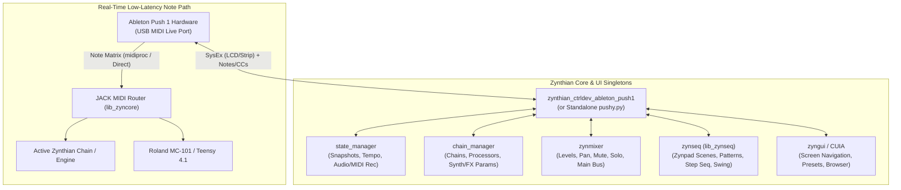

# Ableton Push 1 Hardware & Zynthian Native Control Reference (`pushy` Foundation)

## Sources of Information

This document consolidates and cross-verifies all hardware protocols, System Exclusive (SysEx) specifications, MIDI Control Change (CC) and Note tables, color palettes, LCD character sets, and Zynthian integration architectures required to build a complete, native Ableton Push 1 control surface driver (`zynthian_ctrldev` / `pushy.py`) for Zynthian:

1. **Ableton Live 9 Decompiled Remote Scripts ([`gluon/AbletonLive9_RemoteScripts/Push`](https://github.com/gluon/AbletonLive9_RemoteScripts/tree/master/Push))**: Official Python control surface scripts for Ableton Push 1 (`Push.py`, `Consts.py`, `SkinDefault.py`, `Colors.py`, `Sysex.py`, `TouchStripElement.py`, `SpecialMixerComponent.py`, `NoteEditorComponent.py`, `InstrumentComponent.py`). Primary authority for CC/Note identifiers, SysEx command framing, touchstrip configurations, scale matrices, and LED color indices.
2. **Ableton Push Modding / Customizing Blog ([`pushmod.blogspot.com` — "The Ableton Push is definitely some..."](https://pushmod.blogspot.com/2014/05/the-ableton-push-is-definitely-some.html))**: Reverse-engineering research by Marcelo Dantas (*Mockba the Borg*) detailing standalone Push 1 hardware initialization, dual USB MIDI port topology (`Live Port` vs. `User Port`), button LED brightness states, and custom host communication outside Ableton Live.
3. **Ableton Forum LCD Reverse Engineering ([`forum.ableton.com/viewtopic.php?t=193744`](https://forum.ableton.com/viewtopic.php?t=193744))**: Original May 2013 hardware MIDI capture and discovery of the 77-byte LCD SysEx line-update protocol, column segmentation, and custom character table (`0x00`–`0x7F`).
4. **Cycling '74 Max/MSP Push LCD Control Reference ([`cycling74.com/forums/how-to-control-the-push-lcd-with-sysex-messages`](https://cycling74.com/forums/how-to-control-the-push-lcd-with-sysex-messages))**: Practical implementation guide for formatting and routing 68-character ASCII/glyph line buffers to the Push 1 display over raw MIDI SysEx.
5. **JBrumby's Zynthian UI Push 1 Driver Fork & PR #535 ([`JBrumby/zynthian-ui`](https://github.com/JBrumby/zynthian-ui) & [`zynthian/zynthian-ui#535`](https://github.com/zynthian/zynthian-ui/pull/535))**: Native Zynthian `ctrldev` driver implementation for Ableton Push 1 (`zynthian_ctrldev_ableton_push.py` / `zynthian_ctrldev_ableton_push1.py`), covering LCD controller screen rendering, Zynpad clip launching, Zynmixer feedback, and chain routing.
6. **Garren Smith's WebMIDI Push Library ([`garrensmith/abletonpush`](https://github.com/garrensmith/abletonpush))**: JavaScript hardware abstraction mapping the Push 1 pad grid, isomorphic scale layouts, rotary encoders, and LCD text strips.
7. **Parabuzzle's Custom Ableton Push Scripts ([`parabuzzle/ableton_push`](https://github.com/parabuzzle/ableton_push))**: Extended Python remote scripts demonstrating custom quantization, step-sequencer workflow overrides, and extended scale definitions on Push 1.
8. **DrivenByMoss Documentation & Push 1 Implementation ([`git-moss/DrivenByMoss-Documentation`](https://github.com/git-moss/DrivenByMoss-Documentation))**: Jürgen Moßgraber's comprehensive multi-DAW control surface architecture for Push 1, providing proven UI/UX patterns for mapping Push 1's 4x68 character display and 8x8 pad matrix to non-Ableton hosts (session view, step sequencers, mixer banks, and deep parameter pages).
9. **Zynthian Community Push 1 Driver Discussion ([`discourse.zynthian.org/t/driver-for-ableton-push-1-first-steps/12166`](https://discourse.zynthian.org/t/driver-for-ableton-push-1-first-steps/12166))**: Community and core developer (`tunagenes`, `JBrumby`, `jofemodo`, `riban`) architectural blueprint covering `zynthian_ctrldev` inheritance, Python thread jitter limitations during live pad playing, and the `midiproc` / JACK real-time MIDI routing architecture.
10. **Zynthian Core Architecture (`zynthian-ui` / `zyngine` / `zyngui`)**: Official Zynthian Oram/Vangelis API specifications for `zynthian_ctrldev_base`, `zynpad` (`zynseq`), `zynmixer`, `state_manager`, Chain Manager, and Callable UI Actions (`CUIA`).

---

## 1. Hardware Architecture & USB MIDI Topology

The Ableton Push 1 (co-engineered by Ableton and Akai Professional, USB Vendor ID `0x09E8`, Product ID `0x0015`) is a class-compliant USB MIDI 1.0 device. Unlike Push 2 (which requires a custom USB bulk display driver), **Push 1 is 100% controlled via standard MIDI messages (Notes, CCs, Aftertouch, Pitch Bend) and MIDI System Exclusive (SysEx) messages**, making it ideal for embedded Linux hosts like Raspberry Pi / Zynthian.

### 1.1 Dual USB MIDI Ports
When connected to Linux (ALSA / JACK), Push 1 exposes **two bidirectional MIDI ports**:

| Port Index | ALSA / JACK Port Name | Purpose in Ableton Live | Recommended Role in Zynthian (`mc-zynthian`) |
|---|---|---|---|
| **Port 1 (Port 0)** | `Ableton Push MIDI 1` (**Live Port**) | Primary control surface port used by `Push.py`. Always active in Live Mode. | **Primary Control Surface Port (`ctrldev`)**: Bind `zynthian_ctrldev_ableton_push1` to this port for all LCD SysEx, pad matrix modes, mixer, sequencer, and parameter control. |
| **Port 2 (Port 1)** | `Ableton Push MIDI 2` (**User Port**) | Secondary port activated when pressing the `[User]` button (`CC 59`). | **Dedicated Passthrough / External Hardware Port**: Can be routed in JACK directly to external hardware (e.g., Roland MC-101 or Teensy 4.1) when Push is toggled to User Mode. |

### 1.2 Power & Hardware Illumination Nuances
- **USB Bus Power vs. External 12V DC PSU**: Push 1 operates on USB bus power alone at reduced LED/LCD backlight brightness. Connecting the external 12V DC power supply automatically boosts LCD backlight and RGB pad brightness to 100%.
- **Zero-Config Class Compliance**: No kernel quirks or proprietary drivers are needed on Zynthian OS; `a2jmidid` / JACK raw MIDI exposes both ports immediately upon boot or hot-plug.

---

## 2. Complete Push 1 System Exclusive (SysEx) Protocol

All Push 1 SysEx messages share a 4-byte Akai/Ableton header and terminate with `0xF7`:

```text
Hex:     F0 47 7F 15 <command_id> <length_msb> <length_lsb> [payload...] F7
Decimal: 240 71 127 21 <command_id> <length_msb> <length_lsb> [payload...] 247
```

| Byte | Hex | Dec | Description |
|---|---|---|---|
| 0 | `F0` | `240` | Start of System Exclusive (`SYSEX_START`) |
| 1 | `47` | `71` | Manufacturer ID (Akai Professional / Ableton) |
| 2 | `7F` | `127` | Device ID (`7F` = Broadcast / All-Call) |
| 3 | `15` | `21` | Product Model ID (`15` = Ableton Push 1) |
| 4 | `cmd` | `cmd` | Sub-command ID (Display line, Mode switch, Touchstrip, Aftertouch, etc.) |
| 5 | `00` | `0` | Payload Length MSB (7-bit) |
| 6 | `len` | `len` | Payload Length LSB (7-bit, number of bytes following before `F7`) |
| `7..n`| `...` | `...` | Data payload (all bytes must be 7-bit: `0x00`..`0x7F`) |
| `n+1` | `F7` | `247` | End of System Exclusive (`SYSEX_END`) |

### 2.1 Device Identity & Mode Switching (`Live` vs. `User` Mode)
- **Standard MIDI Device Inquiry Request**:
  `F0 7E 7F 06 01 F7`
- **Push 1 Identity Reply**:
  `F0 7E 00 06 02 47 15 00 19 00 <fw_maj> 00 <fw_min> ... F7`
- **Set Operational Mode (`cmd = 0x62` / `98`)**:
  ```text
  F0 47 7F 15 62 00 01 <mode> F7
  ```
  - `<mode> = 0x00`: **Live Mode** (Native Control Surface mode; `Push.py` default).
  - `<mode> = 0x01`: **User Mode** (User MIDI port active).

### 2.2 LCD Display Protocol (`cmd = 0x18..0x1B` / `24..27`)
The Push 1 display is a high-contrast alphanumeric LCD divided into **4 rows of 68 characters each**, physically split across **4 display glass segments** (17 characters per segment, aligned beneath pairs of the 8 rotary encoders).

#### Line Update SysEx Message (77 Bytes Total)
```text
Hex:     F0 47 7F 15 <line_id> 00 45 00 [68 character bytes: c0 .. c67] F7
Decimal: 240 71 127 21 <line_id> 0 69 0 [68 character bytes: c0 .. c67] 247
```

| Field | Hex | Dec | Description |
|---|---|---|---|
| `<line_id>` | `18` | `24` | **Line 1** (Top row — typically Parameter Names or Encoder Headers) |
| `<line_id>` | `19` | `25` | **Line 2** (Second row — typically Parameter Values or Visual Bargraphs) |
| `<line_id>` | `1A` | `26` | **Line 3** (Third row — typically Track/Chain Names or Menu Items) |
| `<line_id>` | `1B` | `27` | **Line 4** (Bottom row — typically Softkey Labels aligned with buttons `[20..27]`) |
| Length | `00 45` | `0 69` | 69 payload bytes (`1` offset byte `0x00` + `68` character bytes) |
| Offset | `00` | `0` | Character start offset (`0x00` = start at column 0) |
| Chars | `c0..c67`| `0..127`| **Exactly 68 bytes** (`0x20` = ASCII space). Shorter strings MUST be padded to 68 bytes! |

#### Physical Column Layout & 8-Column Alignment Math
Because the 68 characters are divided across 4 physical LCD blocks of 17 characters (`4 * 17 = 68`), and each 17-character block serves **2 encoders** (with 1 separator space in the middle of each block), aligning text under the **8 encoders / 8 softkey buttons** uses **8 cells of 8 characters** plus **4 separator spaces**:

```text
Block 1 (Cols 00..16)   Block 2 (Cols 17..33)   Block 3 (Cols 34..50)   Block 4 (Cols 51..67)
[Enc 1 ] [sp] [Enc 2 ]  [Enc 3 ] [sp] [Enc 4 ]  [Enc 5 ] [sp] [Enc 6 ]  [Enc 7 ] [sp] [Enc 8 ]
00....07  08  09....16  17....24  25  26....33  34....41  42  43....50  51....58  59  60....67
```

- **8-Column Cell Start Indices**: `[0, 9, 17, 26, 34, 43, 51, 60]` (each cell is `8` chars wide; indices `8`, `25`, `42`, `59` are 1-char separators, usually `0x20` space).
- **4-Column Cell Start Indices**: `[0, 17, 34, 51]` (each cell is `17` chars wide, no internal gap required because physical bezel separates blocks).

#### Clear Line & Clear Screen Commands
To clear an entire line without sending 68 spaces, send command `0x1C..0x1F` (`28..31`):
- **Clear Line 1**: `F0 47 7F 15 1C 00 00 F7`
- **Clear Line 2**: `F0 47 7F 15 1D 00 00 F7`
- **Clear Line 3**: `F0 47 7F 15 1E 00 00 F7`
- **Clear Line 4**: `F0 47 7F 15 1F 00 00 F7`

#### LCD Contrast & Backlight Calibration
- **Set LCD Contrast (`cmd = 0x7A` / `122`)**: `F0 47 7F 15 7A 00 01 <val> F7` (`<val>`: `0x00`..`0x7F`).

#### Complete Push 1 Custom Character & Glyph Table (`0x00`–`0x7F`)
Standard printable ASCII occupies `0x20` (`32`, Space) through `0x7E` (`126`, `~`). Push 1 includes special UI glyphs in `0x00`–`0x1F` and `0x7F` (from `Consts.py` in `AbletonLive9_RemoteScripts/Push` and Ableton forum captures):

| Hex | Dec | Glyph / Symbol | Description & UI Usage |
|---|---|---|---|
| `00` | `0` | `↑` | Up Arrow |
| `01` | `1` | `↓` | Down Arrow |
| `02` | `2` | `≡` | Three horizontal bars (Hamburger / Menu icon) |
| `03` | `3` | `\|` | Vertical center tick (Pan center mark) |
| `04` | `4` | `\|` | Left-aligned vertical bar |
| `05` | `5` | `\|` | Right-aligned vertical bar |
| `06` | `6` | `█` | **Full Horizontal Bar Block** (2 ticks filled — used for continuous parameter bargraphs) |
| `07` | `7` | `▌` | **Half Horizontal Bar Block** (1 left tick filled — used for odd steps in bargraphs) |
| `08` | `8` | `─` | Folder / Hierarchy elbow (`└─`) |
| `09` | `9` | `°` | Degree symbol |
| `0A` | `10` | `ä` | Latin small `a` with diaeresis |
| `0B` | `11` | `à` | Latin small `a` with grave |
| `0C` | `12` | `ç` | Latin small `c` with cedilla |
| `0D` | `13` | `ê` | Latin small `e` with circumflex |
| `0E` | `14` | `é` | Latin small `e` with acute |
| `0F` | `15` | `è` | Latin small `e` with grave |
| `10` | `16` | `î` | Latin small `i` with circumflex |
| `11` | `17` | `ï` | Latin small `i` with diaeresis |
| `12` | `18` | `ñ` | Latin small `n` with tilde |
| `13` | `19` | `ö` | Latin small `o` with diaeresis |
| `14` | `20` | `ô` | Latin small `o` with circumflex |
| `15` | `21` | `ß` | German Eszett (`ß`) |
| `16` | `22` | `ü` | Latin small `u` with diaeresis |
| `17` | `23` | `û` | Latin small `u` with circumflex |
| `18` | `24` | `ù` | Latin small `u` with grave |
| `19` | `25` | `♭` | Musical Flat symbol (`b`) |
| `1A` | `26` | `♯` | Musical Sharp symbol (`#`) |
| `1B` | `27` | `…` | Horizontal Ellipsis (`...` in a single character cell — great for truncating long names!) |
| `1C` | `28` | `□` | Empty / hollow block (Unfilled bargraph segment, `CHAR_BAR_EMPTY`) |
| `1D` | `29` | `▐` | Right-half block (Pan right indicator) |
| `1E` | `30` | `◀` | Solid Left Arrow (`◄` — Selected item / Scroll left indicator) |
| `1F` | `31` | `▶` | Solid Right Arrow (`►` — Selected item / Folder / Playing indicator) |
| `20`..`7E`| `32`..`126`| ASCII | Standard printable ASCII (`Space` through `~`) |
| `7F` | `127` | `→` | Right thin arrow |

##### Rendering Parameter Bargraphs & Pan Sliders on the LCD
Using glyphs `0x06` (`█`), `0x07` (`▌`), and `0x1C` (`□` or `-`):
- **Unipolar Bargraph (8 chars wide = 16 steps of resolution)**:
  For a normalized value $v \in [0.0, 1.0]$, total half-blocks $n = \text{round}(v \times 16)$:
  - Number of full blocks (`0x06`) = $n // 2$
  - Half block (`0x07`) = $1$ if $(n \bmod 2) == 1$ else $0$
  - Remaining characters = `0x1C` (or space `0x20`)
- **Bipolar Pan Bargraph (8 chars wide)**:
  Center characters `3` and `4` hold `0x03` (`|`), with left/right fills expanding outward.

### 2.3 Touchstrip Configuration & LED Control (`TouchStripElement.py`)
By default, touching and sliding the 24-LED touchstrip sends **MIDI Pitch Bend** (`0xE0 lsb msb`, 14-bit value `0..16383`, center `8192`) and **Note 12** (`0x90 0x0C 0x7F` on touch, `0x80 0x0C 0x00` on release).

- **Set Touchstrip Configuration (`cmd = 0x63` / `99`)**:
  ```text
  F0 47 7F 15 63 00 01 <config_byte> F7
  ```
  The 7-bit `<config_byte>` is a bitfield (`TouchStripElement.py`):
  - **Bit 0 (`0x01`)**: LEDs Controlled by Host (`0` = Push hardware controls LEDs internally; `1` = Host controls LEDs via SysEx `0x64`).
  - **Bit 1 (`0x02`)**: Host Sends Values (`0` = Touchstrip sends Pitch Bend; `1` = Touchstrip sends Modulation `CC 1`).
  - **Bit 2 (`0x04`)**: Autoreturn (`0` = Latch / hold value on release; `1` = Spring back to center/zero on release).
  - **Bit 3 (`0x08`)**: Bar vs. Point Display (`0` = Single LED dot; `1` = Filled LED bar).
  - **Bit 4 (`0x10`)**: Bipolar Center Start (`0` = Bar starts from bottom LED 0; `1` = Bar starts from center LED 12).

  **Common Preset `<config_byte>` Values**:
  | Mode Name | Hex | Dec | Behavior |
  |---|---|---|---|
  | **Pitch Bend (Default)** | `1C` | `28` | Autoreturn ON, Bar from Center, Hardware LEDs, sends Pitch Bend |
  | **Mod Wheel / Fader** | `0A` | `10` | Autoreturn OFF, Bar from Bottom, Hardware LEDs, sends `CC 1` (or Pitch Bend `0x08`) |
  | **Pan / Bipolar Latch** | `18` | `24` | Autoreturn OFF, Bar from Center |
  | **Custom Host LEDs** | `01` | `1` | Host controls all 24 LEDs directly via command `0x64` |

- **Set Touchstrip 24 LEDs Directly (`cmd = 0x64` / `100`, requires Bit 0 = `1` in `0x63`)**:
  ```text
  F0 47 7F 15 64 00 08 <b0> <b1> <b2> <b3> <b4> <b5> <b6> <b7> F7
  ```
  Each of the 8 payload bytes (`<b0>..<b7>`) packs the brightness of **3 consecutive LEDs** (24 LEDs total, bottom to top), with 2 bits per LED (`0` = Off, `1` = Dim, `2` = Medium, `3` = Full):
  $$\text{byte}_k = \text{LED}_{3k} \mid (\text{LED}_{3k+1} \ll 2) \mid (\text{LED}_{3k+2} \ll 4)$$

### 2.4 Pad Velocity Curve & Aftertouch Mode (`Sysex.py`)
- **Set Aftertouch Mode (`cmd = 0x5C` / `92`)**:
  ```text
  F0 47 7F 15 5C 00 01 <mode> F7
  ```
  - `<mode> = 0x00`: **Channel Aftertouch** (`0xD0 val`, default).
  - `<mode> = 0x01`: **Polyphonic Key Pressure / Poly Aftertouch** (`0xA0 note val` — enables per-pad expressive modulation!).
- **Set Pad Aftertouch Threshold / Range (`cmd = 0x5B` / `91`)**:
  `F0 47 7F 15 5B 00 09 00 00 00 01 <low_thresh> <high_thresh> ... F7`

---

## 3. Complete Hardware Input & Output MIDI Map

All messages on the Live Port (Port 1) use **MIDI Channel 1** (`status & 0x0F == 0`, i.e., `0x90` Note On, `0x80` Note Off, `0xB0` Control Change, `0xE0` Pitch Bend, `0xD0`/`0xA0` Aftertouch).

### 3.1 Endless Rotary Encoders (Turn = CC, Touch = Note)
Push 1 features **11 touch-capacitive endless rotary encoders**.
- **Turning an encoder** sends Relative 2's Complement Control Change (`0xB0 <cc> <val>`):
  - **Clockwise (Increment)**: `val` = `1`..`63` (`0x01`..`0x3F`), where $\Delta = +\text{val}$.
  - **Counter-Clockwise (Decrement)**: `val` = `127` down to `65` (`0x7F`..`0x41`), where $\Delta = \text{val} - 128$ (e.g., `127` = `-1`, `126` = `-2`).
- **Touching / Releasing an encoder cap** sends MIDI Note On (`0x90 <note> 0x7F`) on touch and Note Off (`0x80 <note> 0x00` or `0x90 <note> 0x00`) on release.

| Physical Encoder | Turn CC (Hex / Dec) | Touch Note (Hex / Dec) | Native Ableton Function | Zynthian Target Mapping |
|---|---|---|---|---|
| **Tempo Encoder** (Top Left 1) | `CC 14` (`0x0E`) | `Note 10` (`0x0A`) | Global Tempo (BPM, Shift = 0.1) | Tempo BPM (`zynseq.set_tempo`), Shift = Fine 0.1 BPM |
| **Swing Encoder** (Top Left 2) | `CC 15` (`0x0F`) | `Note 9` (`0x09`) | Global Groove / Swing Amount | Swing / Groove (`zynseq`) or Zynthian UI `SELECT` Knob |
| **Track Encoder 1** (Above Col 1) | `CC 71` (`0x47`) | `Note 0` (`0x00`) | Parameter / Mixer Col 1 | Parameter 1 / Mixer Ch 1 / Zynctrl 1 |
| **Track Encoder 2** (Above Col 2) | `CC 72` (`0x48`) | `Note 1` (`0x01`) | Parameter / Mixer Col 2 | Parameter 2 / Mixer Ch 2 / Zynctrl 2 |
| **Track Encoder 3** (Above Col 3) | `CC 73` (`0x49`) | `Note 2` (`0x02`) | Parameter / Mixer Col 3 | Parameter 3 / Mixer Ch 3 / Zynctrl 3 |
| **Track Encoder 4** (Above Col 4) | `CC 74` (`0x4A`) | `Note 3` (`0x03`) | Parameter / Mixer Col 4 | Parameter 4 / Mixer Ch 4 / Zynctrl 4 |
| **Track Encoder 5** (Above Col 5) | `CC 75` (`0x4B`) | `Note 4` (`0x04`) | Parameter / Mixer Col 5 | Parameter 5 / Mixer Ch 5 / Zynctrl 1 (Page +1) |
| **Track Encoder 6** (Above Col 6) | `CC 76` (`0x4C`) | `Note 5` (`0x05`) | Parameter / Mixer Col 6 | Parameter 6 / Mixer Ch 6 / Zynctrl 2 (Page +1) |
| **Track Encoder 7** (Above Col 7) | `CC 77` (`0x4D`) | `Note 6` (`0x06`) | Parameter / Mixer Col 7 | Parameter 7 / Mixer Ch 7 / Zynctrl 3 (Page +1) |
| **Track Encoder 8** (Above Col 8) | `CC 78` (`0x4E`) | `Note 7` (`0x07`) | Parameter / Mixer Col 8 | Parameter 8 / Mixer Ch 8 / Zynctrl 4 (Page +1) |
| **Master Encoder** (Top Right) | `CC 79` (`0x4F`) | `Note 8` (`0x08`) | Master Track Volume | Main Mixbus Volume (`zynmixer` Main Level) |

### 3.2 Display Softkey Buttons (2 Rows of 8 Beneath the LCD)
Pressing sends `0xB0 <cc> 0x7F`; releasing sends `0xB0 <cc> 0x00`. Writing `0xB0 <cc> <color_val>` sets the button LED.

| Column | Upper Row Softkey (`State Buttons 1..8`) | LED Type (Upper Row) | Lower Row Softkey (`Select Buttons 1..8`) | LED Type (Lower Row) |
|---|---|---|---|---|
| **Col 1** | `CC 20` (`0x14`) | Bi-LED (Red/Amber/Yellow/Green) | `CC 102` (`0x66`) | Full RGB Palette (`0..127`) |
| **Col 2** | `CC 21` (`0x15`) | Bi-LED (Red/Amber/Yellow/Green) | `CC 103` (`0x67`) | Full RGB Palette (`0..127`) |
| **Col 3** | `CC 22` (`0x16`) | Bi-LED (Red/Amber/Yellow/Green) | `CC 104` (`0x68`) | Full RGB Palette (`0..127`) |
| **Col 4** | `CC 23` (`0x17`) | Bi-LED (Red/Amber/Yellow/Green) | `CC 105` (`0x69`) | Full RGB Palette (`0..127`) |
| **Col 5** | `CC 24` (`0x18`) | Bi-LED (Red/Amber/Yellow/Green) | `CC 106` (`0x6A`) | Full RGB Palette (`0..127`) |
| **Col 6** | `CC 25` (`0x19`) | Bi-LED (Red/Amber/Yellow/Green) | `CC 107` (`0x6B`) | Full RGB Palette (`0..127`) |
| **Col 7** | `CC 26` (`0x1A`) | Bi-LED (Red/Amber/Yellow/Green) | `CC 108` (`0x6C`) | Full RGB Palette (`0..127`) |
| **Col 8** | `CC 27` (`0x1B`) | Bi-LED (Red/Amber/Yellow/Green) | `CC 109` (`0x6D`) | Full RGB Palette (`0..127`) |

### 3.3 Scene Launch / Grid Quantization Buttons (Right of 8x8 Pad Grid)
Ordered from **Top (Row 1) to Bottom (Row 8)** (`Consts.py` `SCENE_LAUNCH_CCS`):

| Row (Top to Bottom) | Physical Label | CC Number (Dec / Hex) | LED Type | Native Function / Shift Function |
|---|---|---|---|---|
| **Row 1 (Top)** | `1/32t` | `CC 43` (`0x2B`) | Bi-LED | Launch Scene 1 / Quantize or Repeat `1/32t` |
| **Row 2** | `1/32` | `CC 42` (`0x2A`) | Bi-LED | Launch Scene 2 / Quantize or Repeat `1/32` |
| **Row 3** | `1/16t` | `CC 41` (`0x29`) | Bi-LED | Launch Scene 3 / Quantize or Repeat `1/16t` |
| **Row 4** | `1/16` | `CC 40` (`0x28`) | Bi-LED | Launch Scene 4 / Quantize or Repeat `1/16` |
| **Row 5** | `1/8t` | `CC 39` (`0x27`) | Bi-LED | Launch Scene 5 / Quantize or Repeat `1/8t` |
| **Row 6** | `1/8` | `CC 38` (`0x26`) | Bi-LED | Launch Scene 6 / Quantize or Repeat `1/8` |
| **Row 7** | `1/4t` | `CC 37` (`0x25`) | Bi-LED | Launch Scene 7 / Quantize or Repeat `1/4t` |
| **Row 8 (Bottom)** | `1/4` | `CC 36` (`0x24`) | Bi-LED | Launch Scene 8 / Quantize or Repeat `1/4` |

### 3.4 Complete Front-Panel Function Buttons Map (`Push.py`)

| Physical Section | Button Label | CC (Dec) | CC (Hex) | LED Type | Zynthian Functional Assignment |
|---|---|---|---|---|---|
| **Top Left** | `Tap Tempo` | `CC 3` | `0x03` | Mono | Tap Tempo (`CUIA: TEMPO` / tap calculation) |
| **Top Left** | `Metronome` | `CC 9` | `0x09` | Mono | Toggle Metronome (`zynseq` Metronome On/Off) |
| **Left Edit Column** | `Delete` | `CC 118` | `0x76` | Mono | Delete Clip / Clear Step / Remove Processor (+Hold) |
| **Left Edit Column** | `Undo` | `CC 119` | `0x77` | Mono | Undo (`CUIA: ZYNSWITCH` / `MC-101` Undo / Sequencer Undo) |
| **Left Track State** | `Mute` | `CC 60` | `0x3C` | Bi-LED | Mute Selected Chain (or Hold to Momentary Mute Chains 1..8) |
| **Left Track State** | `Solo` | `CC 61` | `0x3D` | Bi-LED | Solo Selected Chain (or Hold to Momentary Solo Chains 1..8) |
| **Left Track State** | `Stop` (Stop Clip) | `CC 29` | `0x1D` | Bi-LED | Stop Clip on Chain (Shift+Stop = Stop All Clips / Panic) |
| **Left Workflow Column**| `Fixed Length` | `CC 90` | `0x5A` | Mono | Set Pattern Length (1, 2, 4, 8, 16 bars in `zynseq`) |
| **Left Workflow Column**| `Automation` | `CC 89` | `0x59` | Bi-LED | Toggle MIDI CC / Motion Automation Recording |
| **Left Workflow Column**| `Duplicate` | `CC 88` | `0x58` | Mono | Clone Pattern / Duplicate Measure or Sequence |
| **Left Workflow Column**| `New` | `CC 87` | `0x57` | Mono | Select Next Empty Pattern Slot in `zynpad` |
| **Left Transport** | `Record` | `CC 86` | `0x56` | Bi-LED | Toggle Step/Live MIDI Record (`CUIA: TOGGLE_MIDI_RECORD`) |
| **Left Transport** | `Play` | `CC 85` | `0x55` | Bi-LED | Start / Stop Sequencer & Transport (`CUIA: TOGGLE_PLAY`) |
| **Right Top Master** | `Master` | `CC 28` | `0x1C` | Mono | Select Main Mixbus Chain (`chain_id = 0`) / Master FX |
| **Right Top Routing** | `In` (Step In) | `CC 62` | `0x3E` | Mono | Chain MIDI/Audio Input Routing (`Chain Options -> MIDI In`) |
| **Right Top Routing** | `Out` (Step Out) | `CC 63` | `0x3F` | Mono | Chain Audio/MIDI Output Routing (`Chain Options -> Audio Out`) |
| **Right Encoder Modes** | `Volume` | `CC 114` | `0x72` | Mono | **Mixer Volume Mode** (Encoders 1–8 control Chain Volumes) |
| **Right Encoder Modes** | `Pan & Send` | `CC 115` | `0x73` | Mono | **Mixer Pan/Send Mode** (Cycle Pan $\rightarrow$ Send 1 $\rightarrow$ Send 2) |
| **Right Encoder Modes** | `Track` | `CC 112` | `0x70` | Mono | **Single-Chain Channel Strip Mode** (Vol, Pan, Balance, Mute, Solo, Sends) |
| **Right Encoder Modes** | `Clip` | `CC 113` | `0x71` | Mono | **Pattern/Sequence Settings Mode** (Beats/Bar, Length, Scale, Quantize) |
| **Right Encoder Modes** | `Device` | `CC 110` | `0x6E` | Mono | **Synth/FX Parameter Control Mode** (Deep instrument & MC-101 editing) |
| **Right Encoder Modes** | `Browse` | `CC 111` | `0x6F` | Mono | **Preset & Engine Browser Mode** (Navigate Zynthian Banks & Presets) |
| **Right Grid Modes** | `Add Effect` | `CC 52` | `0x34` | Mono | Add Audio/MIDI Effect Processor to Active Chain |
| **Right Grid Modes** | `Add Track` | `CC 53` | `0x35` | Mono | Create New Synth/Audio/MIDI Chain (`add_chain`) |
| **Right Grid Modes** | `Note` | `CC 50` | `0x32` | Mono | **Live Play / Step Sequencer Mode** (Toggle Isometric / Drum / Seq) |
| **Right Grid Modes** | `Session` | `CC 51` | `0x33` | Mono | **Zynpad Clip & Scene Launcher Mode** (8x8 Pattern Grid) |
| **Right Grid Modes** | `Scales` | `CC 58` | `0x3A` | Mono | Open Musical Scale, Root Key & In-Key/Chromatic Layout Menu |
| **Right Grid Modes** | `User` | `CC 59` | `0x3B` | Mono | Toggle User Mode / Dedicated External Synth Control Layer (`MC-101`) |
| **Right Performance** | `Repeat` | `CC 56` | `0x38` | Mono | Toggle Note Repeat / Arpeggiator |
| **Right Performance** | `Accent` | `CC 57` | `0x39` | Mono | Toggle Fixed Full Velocity (`127`) for Pads |
| **Right Octave / Page** | `Octave Up` | `CC 55` | `0x37` | Mono | Shift Pad Octave `+1` (or Page Up in Sequencer) |
| **Right Octave / Page** | `Octave Down` | `CC 54` | `0x36` | Mono | Shift Pad Octave `-1` (or Page Down in Sequencer) |
| **Right Navigation** | `Cursor Up` (`▲`) | `CC 46` | `0x2E` | Mono | Navigate Up / Move Session Ring Up / Menu Up |
| **Right Navigation** | `Cursor Down` (`▼`) | `CC 47` | `0x2F` | Mono | Navigate Down / Move Session Ring Down / Menu Down |
| **Right Navigation** | `Cursor Left` (`◀`) | `CC 44` | `0x2C` | Mono | Navigate Left / Prev Parameter Page / Bank Left |
| **Right Navigation** | `Cursor Right` (`▶`)| `CC 45` | `0x2D` | Mono | Navigate Right / Next Parameter Page / Bank Right |
| **Right Modifiers** | `Select` | `CC 48` | `0x30` | Mono | Hold to Select Pad/Clip/Chain/Step without triggering it |
| **Right Modifiers** | `Shift` | `CC 49` | `0x31` | Mono | Hold for Secondary Functions & Fine-Resolution Encoder Turns |
| **Rear Footswitches** | `Footswitch 1` | `CC 64` | `0x40` | — | Sustain Pedal (`CC 64`) |
| **Rear Footswitches** | `Footswitch 2` | `CC 69` | `0x45` | — | Hands-Free Punch Record / Clip Launch (`CC 69`) |

### 3.5 The 8x8 Velocity & Pressure-Sensitive Pad Matrix (`Notes 36..99`)
The 64 RGB pads send and receive **MIDI Note messages (`Notes 36..99` / `0x24..0x63`)** on Channel 1:
- **Bottom-Left Pad (Row 0, Col 0)**: `Note 36` (`0x24`, `C1`)
- **Bottom-Right Pad (Row 0, Col 7)**: `Note 43` (`0x2B`, `G1`)
- **Top-Left Pad (Row 7, Col 0)**: `Note 92` (`0x5C`, `G#5`)
- **Top-Right Pad (Row 7, Col 7)**: `Note 99` (`0x63`, `D#6`)

#### Complete 8x8 Pad Coordinate-to-MIDI-Note Grid
Formula: $\text{note}(\text{row}, \text{col}) = 36 + (\text{row} \times 8) + \text{col}$, where $\text{row} \in \{0..7\}$ (bottom to top) and $\text{col} \in \{0..7\}$ (left to right).
For top-down UI indexing ($\text{top\_row} = 7 - \text{row} \in \{0..7\}$ from top to bottom):
$$\text{note}(\text{top\_row}, \text{col}) = 92 - (\text{top\_row} \times 8) + \text{col}$$

| Grid Row | Col 0 | Col 1 | Col 2 | Col 3 | Col 4 | Col 5 | Col 6 | Col 7 | Scene Button |
|---|---|---|---|---|---|---|---|---|---|
| **Row 7 (Top)** | `92` (`5C`) | `93` (`5D`) | `94` (`5E`) | `95` (`5F`) | `96` (`60`) | `97` (`61`) | `98` (`62`) | `99` (`63`) | `CC 43` (`1/32t`)|
| **Row 6** | `84` (`54`) | `85` (`55`) | `86` (`56`) | `87` (`57`) | `88` (`58`) | `89` (`59`) | `90` (`5A`) | `91` (`5B`) | `CC 42` (`1/32`) |
| **Row 5** | `76` (`4C`) | `77` (`4D`) | `78` (`4E`) | `79` (`4F`) | `80` (`50`) | `81` (`51`) | `82` (`52`) | `83` (`53`) | `CC 41` (`1/16t`)|
| **Row 4** | `68` (`44`) | `69` (`45`) | `70` (`46`) | `71` (`47`) | `72` (`48`) | `73` (`49`) | `74` (`4A`) | `75` (`4B`) | `CC 40` (`1/16`) |
| **Row 3** | `60` (`3C`) | `61` (`3D`) | `62` (`3E`) | `63` (`3F`) | `64` (`40`) | `65` (`41`) | `66` (`42`) | `67` (`43`) | `CC 39` (`1/8t`) |
| **Row 2** | `52` (`34`) | `53` (`35`) | `54` (`36`) | `55` (`37`) | `56` (`38`) | `57` (`39`) | `58` (`3A`) | `59` (`3B`) | `CC 38` (`1/8`) |
| **Row 1** | `44` (`2C`) | `45` (`2D`) | `46` (`2E`) | `47` (`2F`) | `48` (`30`) | `49` (`31`) | `50` (`32`) | `51` (`33`) | `CC 37` (`1/4t`) |
| **Row 0 (Bottom)**| `36` (`24`) | `37` (`25`) | `38` (`26`) | `39` (`27`) | `40` (`28`) | `41` (`29`) | `42` (`2A`) | `43` (`2B`) | `CC 36` (`1/4`) |

---

## 4. LED Color Palettes, Animation Channels & Skin System (`Colors.py` & `SkinDefault.py`)

Push 1 uses three distinct LED hardware types, all controlled by sending standard MIDI Note On (`0x9n`) or Control Change (`0xBn`) messages where the **velocity / value byte (`0..127`) selects the color or brightness**, and the **MIDI Channel (`n = 0..15`) selects static vs. animated blinking/pulsing**.

### 4.1 MIDI Channel Animation States (Applies to Pads & Buttons)
From `Colors.py` (`Blink`, `Pulse`, `OneShot`):
- **Channel 1 (`0x90` / `0xB0`, `ch = 0`)**: **Static Solid Color** (Velocity `0..127` sets the color).
- **Channels 2–6 (`ch = 1..5`)**: **One-Shot Transition** (Transitions from previous color to new color over 24th, 16th, 8th, Quarter, or Half note duration).
- **Channels 7–11 (`0x96`..`0x9A`, `ch = 6..10`)**: **Pulsing (Breathing) Animation** synced to MIDI Clock (`ch 6`: 1/24, `ch 7`: 1/16, `ch 8`: 1/8, `ch 9`: 1/4, `ch 10`: 1/2).
- **Channels 12–16 (`0x9B`..`0x9F`, `ch = 11..15`)**: **Blinking (Fast Toggle) Animation** (`ch 11`: 1/24, `ch 12`: 1/16, `ch 13`: 1/8, `ch 14`: 1/4, `ch 15`: 1/2).
  > *Tip*: To make a pad blink between Color A and Color B, first send Color A on **Channel 1** (`0x90 <note> <color_A>`), then immediately send Color B on **Channel 14** (`0x9D <note> <color_B>`).

### 4.2 Monochrome Buttons (`Basic` Class in `Colors.py`)
Used for function buttons (`Tap Tempo`, `Metronome`, `Master`, `Volume`..`Browse`, `Note`..`Accent`, `Octave`, `Arrows`, `Shift`, `Select`, `Delete`, `Undo`, `Fixed Length`, `Duplicate`, `New`):

| State Name | Velocity / Value | Behavior |
|---|---|---|
| `OFF` | `0` | LED Off |
| `HALF` | `1` | Dimly Lit (Default idle state for available buttons) |
| `HALF_BLINK_SLOW` | `2` | Dim Slow Blink |
| `HALF_BLINK_FAST` | `3` | Dim Fast Blink |
| `FULL` | `4` (or `127`) | Fully Lit (Active / Selected state) |
| `FULL_BLINK_SLOW` | `5` | Bright Slow Blink |
| `FULL_BLINK_FAST` | `6` | Bright Fast Blink |

### 4.3 Bi-Color LED Buttons (`BiLed` Class in `Colors.py`)
Used for Upper Display Softkeys (`CC 20..27`), Scene Launch Buttons (`CC 36..43`), `Mute` (`CC 60`), `Solo` (`CC 61`), `Stop` (`CC 29`), `Play` (`CC 85`), `Record` (`CC 86`), and `Automation` (`CC 89`):

| State Name | Value (Dec) | Hex | Visual Appearance |
|---|---|---|---|
| `OFF` | `0` | `0x00` | LED Off |
| `RED` | `1` | `0x01` | Bright Red |
| `RED_HALF` | `2` | `0x02` | Dim Red |
| `RED_BLINK` | `3` | `0x03` | Blinking Red |
| `AMBER` | `7` | `0x07` | Bright Amber / Orange |
| `AMBER_HALF` | `8` | `0x08` | Dim Amber / Orange |
| `AMBER_BLINK` | `9` | `0x09` | Blinking Amber |
| `YELLOW` | `13` | `0x0D` | Bright Yellow |
| `YELLOW_HALF` | `14` | `0x0E` | Dim Yellow |
| `YELLOW_BLINK`| `15` | `0x0F` | Blinking Yellow |
| `GREEN` | `19` | `0x13` | Bright Green |
| `GREEN_HALF` | `20` | `0x14` | Dim Green |
| `GREEN_BLINK` | `21` | `0x15` | Blinking Green |

### 4.4 Full RGB Palette (`Rgb` Class in `Colors.py`)
Used for the **64 Pads (`Notes 36..99`)** and the **Lower Row Display Softkeys (`CC 102..109`)**. Each primary hue in Ableton's `Rgb` class has 4 brightness/saturation shades (Bright Base `k`, Highlight, Shade 1 `k+1`, Shade 2 `k+2`):

| Color Name (`Rgb.*`) | Bright (`Base`) | Dim 1 (`Shade 1`) | Dim 2 (`Shade 2`) | Highlight | Typical UI Usage (`SkinDefault.py`) |
|---|---|---|---|---|---|
| `BLACK` (Off) | `0` | — | — | — | Empty slot / Unlit pad |
| `DARK_GREY` | `1` | — | — | — | Inactive step / Muted track |
| `GREY` | `2` | — | — | — | Natural scale note / Background |
| `WHITE` | `3` | — | — | — | Active step playhead / Selected note |
| `RED` | `5` | `6` | `7` | `4` | Recording clip / Armed / Delete |
| `AMBER` | `9` | `10` | `11` | `8` | Root note in scale / Drum pad active |
| `YELLOW` | `13` | `14` | `15` | `12` | Drum loop / Selected drum pad |
| `LIME` | `17` | `18` | `19` | `16` | Clip queued / Loop active |
| `GREEN` | `21` | `22` | `23` | `20` | Playing clip / Transport active |
| `SPRING` | `25` | `26` | `27` | `24` | Chain Color / Synth Voice |
| `TURQUOISE` | `29` | `30` | `31` | `28` | Chain Color / Effect |
| `CYAN` | `33` | `34` | `35` | `32` | Chain Color / Audio Track |
| `SKY` | `37` | `38` | `39` | `36` | Scale / Note Repeat indicator |
| `OCEAN` | `41` | `42` | `43` | `40` | Soloed / Selected pad (`40`) |
| `BLUE` | `45` | `46` | `47` | `44` | Root note (alternative) / MIDI Chain |
| `ORCHID` | `49` | `50` | `51` | `48` | Step sequencer high-velocity note |
| `MAGENTA` | `53` | `54` | `55` | `52` | Special / Generator Chain |
| `PINK` | `57` | `58` | `59` | `56` | Automation / Modulation active |
| `WARM_WHITE` | `122` | — | — | — | Warm white natural key |
| `PURE_RED` / `GREEN` / `BLUE` | `127` / `126` / `125` | — | — | — | Pure primary diagnostic LEDs |

*(Note: You can also set any custom 24-bit RGB color into palette index `0..127` using the undocumented Push 1 Color Palette SysEx command `F0 47 7F 15 03 00 08 <idx> <r_lsb> <r_msb> <g_lsb> <g_msb> <b_lsb> <b_msb> F7`!)*

---

## 5. Zynthian Control Architecture & API Reference

To control Zynthian natively like Ableton Live, the Push 1 driver integrates with Zynthian's internal Python singletons (`zynthian-ui` Oram / Vangelis architecture).



### 5.1 Two Deployment Modes: Native `ctrldev` Plugin vs. Standalone Bridge
1. **Native Zynthian `ctrldev` Driver (`zynthian_ctrldev_ableton_push1.py`)**:
   - Placed in `/zynthian/zynthian-ui/zyngine/ctrldev/` (or symlinked from [`scripts/pushy.py`](https://github.com/RowdyVoyeur/mc-zynthian/blob/main/scripts/pushy.py)).
   - Inherits from `zynthian_ctrldev_base`, `zynthian_ctrldev_zynpad`, and `zynthian_ctrldev_zynmixer` (building upon the foundation explored in [`JBrumby/zynthian-ui`](https://github.com/JBrumby/zynthian-ui)).
   - Loaded automatically by `zynthian_ctrldev_manager` when Push 1 (`Ableton Push MIDI 1`) is detected via USB!
   - Has **direct in-process Python access** to `self.state_manager`, `self.chain_manager`, `self.zynmixer`, `self.zynseq`, and `zyngui`.
2. **Standalone Bridge Process (`scripts/pushy.py`)**:
   - Can run on a development machine or as a companion daemon on Zynthian using `mido` / `python-rtmidi` for direct Push 1 + Roland MC-101 SysEx communication, while talking to Zynthian UI via **UDP OSC (Port `1370`)** and `zynmixer` OSC (**Port `1371`**).
   - **Our foundation supports BOTH**: a clean hardware/mode abstraction (`pushy.py`) that works standalone via `mido`/OSC AND includes the native `zynthian_ctrldev_ableton_push1` class wrapper for direct in-process Zynthian execution!

### 5.2 Key Zynthian Community Insights ([Discourse Thread #12166](https://discourse.zynthian.org/t/driver-for-ableton-push-1-first-steps/12166) & [`JBrumby/zynthian-ui`](https://github.com/JBrumby/zynthian-ui))
In the Zynthian community thread *"Driver for Ableton Push 1 - First Steps"* (with contributions from `tunagenes`, `JBrumby`, `jofemodo`, and `riban`), key architectural patterns were established:
1. **Real-Time Pad Latency vs. Python `midi_event()`**:
   - When playing instruments live in **Note Mode**, routing note-on/note-off messages through Python's `midi_event(ev)` in `zynthian-ui` can introduce slight timing jitter if the Python GIL is busy rendering GUI screens.
   - **Solution A (`unroute_from_chains = False` / Selective Consumption)**: If pads use standard notes or `midiproc` (a real-time JACK client / `mididings` filter introduced by `jofemodo`), note events travel directly in the C/JACK real-time thread, while `midi_event(ev)` only updates LEDs or consumes CCs (`return True`).
   - **Solution B (`lib_zyncore.zmip_send_*`)**: When remapping pad notes in Python for custom Isometric Scales (34 scales), keep the Note Mode handler zero-allocation (pre-computed 64-byte lookup array `pad_to_midi_note[64]`) and inject immediately via `lib_zyncore.dev_send_note_on()` / `zmip_send_note_on()`.
2. **LCD Traffic Throttling (Dirty-Diffing)**:
   - Push 1's 4x68 LCD requires 77 bytes per line (308 bytes for a full 4-line refresh). At standard USB MIDI speeds, flooding redundant LCD SysEx on every encoder tick saturates the MIDI buffer.
   - **Mandatory Best Practice**: Maintain a 4-line shadow frame buffer (`_lcd_cache[4]`) and a dirty-flag timer (max 25–30 FPS / 33 ms coalescing). **Only transmit a line's 77-byte SysEx frame when its 68-byte content has actually changed!**

---

## 6. Complete Feature Mapping: Controlling Zynthian Like Ableton Live

Below is the comprehensive mapping of every requested capability from the Ableton Push 1 workflow to Zynthian's native subsystems.

### 6.1 Launch Clips & Scenes (`Session Mode` — `[Session]` Button `CC 51`)
Maps directly to **`zynpad` / `zynseq`**:
- **8x8 Pad Matrix (`Notes 36..99`)**:
  - **Columns `0..7`** represent **8 Chains / Sequence Tracks** (scrollable across all chains via `Cursor Left/Right` `[CC 44/45]`).
  - **Rows `0..7` (Top to Bottom: `Notes 92..99` down to `36..43`)** represent **8 Scenes / Banks of Patterns** in `zynseq` (scrollable via `Cursor Up/Down` `[CC 46/47]`).
  - **Pressing a Pad**: Calls `zynseq.toggle_pad(bank, pad)` or sets `zynseq.libseq.setPlayState(bank, seq, state)`.
- **Pad LED State Feedback (`update_seq_state` callback)**:
  - `STOPPED` (Empty pattern): Off (`0`) or Dim Chain Color (`Shade 2`).
  - `STOPPED` (Pattern contains notes): Dim Chain Color (`Shade 1`).
  - `PLAYING`: Bright Green (`Rgb.GREEN = 21`, pulsing on Channel 9).
  - `STARTING` (Queued to start on next bar): Blinking Green (`Channel 14`, `Rgb.GREEN = 21`).
  - `STOPPING` (Queued to stop): Blinking Red (`Channel 14`, `Rgb.RED = 5`).
- **Right Scene Launch Buttons (`CC 43` down to `CC 36`)**:
  - Pressing launches the corresponding **Zynpad Scene / Bank (`1..8`)** (`zynseq.set_bank(scene_idx)`) and triggers all active clips in that row.
  - Active Scene button lights `BiLed.GREEN` (`19`); other scenes light `BiLed.AMBER_HALF` (`8`).
- **Clip Modifiers while in Session Mode**:
  - **Hold `[Select]` (`CC 48`) + Press Pad**: Selects the pattern for step-editing without launching/stopping it.
  - **Hold `[Delete]` (`CC 118`) + Press Pad**: Clears all notes in that pattern (`zynseq.libseq.clearPattern(pattern_id)`).
  - **Hold `[Duplicate]` (`CC 88`) + Press Pad A $\rightarrow$ Pad B**: Copies Pattern A to Pattern B.
  - **Hold `[Stop]` (`CC 29`) + Press Lower Softkey (`CC 102..109`)**: Immediately stops the playing clip on that track/chain.

### 6.2 Edit Mixer Settings (`Volume`, `Pan & Send`, `Track` Modes)
Controlled via buttons `[Volume]` (`CC 114`), `[Pan & Send]` (`CC 115`), and `[Track]` (`CC 112`), interfacing with **`zynmixer`**:
- **Display Header & Selection Across All Mixer Modes**:
  - **Line 3**: Displays the 8 Chain Names (`8 chars` each, e.g., `1:ZynAdd`, `2:MC-101`, `3:Fluid`, etc.). The currently active chain is prefixed with `▶` (`0x1F`).
  - **Lower Softkeys (`CC 102..109`)**: Select the active Chain (`chain_manager.set_active_chain_by_index()`). Lit with the Chain's assigned color (bright for active, dim for others).
  - **Upper Softkeys (`CC 20..27`)**:
    - Default: Toggle **Mute** (`BiLed.AMBER`) or **Record Arm** (`BiLed.RED`) for Chains 1–8.
    - When `[Mute]` (`CC 60`) is latched/held: Toggle Chain Mute (`zynmixer.toggle_mute(mixer_chan)`).
    - When `[Solo]` (`CC 61`) is latched/held: Toggle Chain Solo (`zynmixer.toggle_solo(mixer_chan)`).
- **`[Volume]` Mode (`CC 114`)**:
  - **Encoders 1–8 (`CC 71..78`)**: Adjust `zynmixer.get_level(chan)` / `zynmixer.set_level(chan, val)` (`0.0` to `1.0`, displayed as `-inf dB` to `+6.0 dB` on Line 1, with an 8-char horizontal bargraph `███▌□□□□` on Line 2).
- **`[Pan & Send]` Mode (`CC 115`)**:
  - Pressing `[Pan & Send]` cycles between **Pan / Balance** (`zynmixer.set_balance(chan, val)`, `-1.0` to `+1.0`) and **FX Sends / Submix Routing** (plus MC-101 Delay/Reverb Sends `CC 92/91`).
  - Touching an encoder cap (`Notes 0..7`) + holding `[Delete]` (`CC 118`) resets Level to `0.0 dB` (`0.8`) or Pan to `0.0` (`Center`)!
- **`[Track]` Mode (`CC 112` — Single-Chain Channel Strip)**:
  - Dedicates all 8 encoders to the **currently selected chain**:
    - `Enc 1`: Volume (`dB`)
    - `Enc 2`: Pan / Balance (`L..C..R`)
    - `Enc 3`: Mute (`ON/OFF`)
    - `Enc 4`: Solo (`ON/OFF`)
    - `Enc 5`: Mono / Stereo toggle (`zynmixer.set_mono`)
    - `Enc 6`: Phase Invert (`zynmixer.set_phase`)
    - `Enc 7`: MIDI Channel assignment
    - `Enc 8`: Audio Output route

### 6.3 Edit Master Volume, Tempo & Swing (Global Controls — Always Active)
- **Master Volume Encoder (`CC 79` + Touch `Note 8`)**:
  - Adjusts the Zynthian Main Mixbus Level (`zynmixer.set_level(MAIN_MIXBUS_CHAN, val)`).
  - **Touching `Note 8`** temporarily overlays a pop-up banner on LCD Line 1/2 showing `Master Volume: -2.4 dB [██████□□]` and Main Mixbus Peak/RMS status, automatically restoring the previous LCD line when released!
- **`[Master]` Button (`CC 28`)**:
  - Selects the **Main Mixbus Chain (`chain_id = 0`)** so `[Device]` mode edits Master Audio Effects (EQ, Compressor, Reverb on the Master bus) or MC-101 Total Effects.
- **Tempo Encoder (`CC 14` + Touch `Note 10`)**:
  - Adjusts `zynseq.get_tempo()` / `zynseq.set_tempo(bpm)`.
  - Normal turn = `±1.0 BPM` per detent; holding `[Shift]` (`CC 49`) + turn = `±0.1 BPM` per detent.
  - Touching `Note 10` shows `Global Tempo: 120.0 BPM` on the LCD.
- **Swing Encoder (`CC 15` + Touch `Note 9`)**:
  - Adjusts `zynseq` Pattern/Bank **Swing Amount** (`libseq.setSwingAmount(val)`, `0%` to `100%`) and Swing Divisor, or acts as Zynthian's UI `SELECT` knob when a Zynthian modal screen is open.

### 6.4 Navigate, Browse & Create Instruments (`[Browse]`, `[Add Track]`, `[Add Effect]`)
Enables completely "eyes-off-the-Pi" chain creation and preset browsing on the Push 4-line LCD:
- **`[Add Track]` (`CC 53`) — Create New Instrument Chain**:
  - Opens the **New Chain Wizard** directly on the Push LCD:
    - **Step 1 (Select Chain Type via Softkeys)**: `[Synth]`, `[Audio FX]`, `[MIDI Tool]`, `[Generator]`, `[MC-101 Track]`.
    - **Step 2 (Select Engine via Encoders 1–8 / Softkeys)**: Lists available Zynthian engines (`ZynAddSubFX`, `FluidSynth`, `LinuxSampler`, `SetBfree`, `Dexed`, `Surge XT`, `Pianoteq`, `SooperLooper`, etc.).
    - **Step 3 (Select MIDI Channel & Confirm)**: Calls `chain_manager.add_chain()` and immediately opens `[Browse]` mode to pick a preset.
- **`[Add Effect]` (`CC 52`) — Insert Audio or MIDI Effect on Current Chain**:
  - Lists available LV2 Audio Effects or MIDI Effects on the Push LCD and attaches the chosen processor into the active chain slot.
- **`[Browse]` (`CC 111`) — Native Bank & Preset Browser**:
  - **Columns 1–4 (Left Half of LCD)**: **Bank List** for the active processor (`processor.bank_list`), scrolled with Encoders 1–4 or `Cursor Up/Down`, selected with Lower Softkeys 1–4.
  - **Columns 5–8 (Right Half of LCD)**: **Preset List** (`processor.preset_list`), scrolled with Encoders 5–8, loaded immediately with Lower Softkeys 5–8 (`processor.set_preset(idx)`).
  - **Upper Softkey 8**: Toggles **Favorite (`★`)** for the highlighted preset (`processor.toggle_preset_fav()`).

### 6.5 Edit All Instrument Parameters Using Knobs & Push Screen (`[Device]` Mode `CC 110`)
Zynthian instruments organize their parameters (`zctrl`) into pages of **4 controllers per screen (`ctrl_screens`)**. Because Push 1 has **8 encoders and 8 display columns**, our driver maps **two consecutive Zynthian 4-parameter pages simultaneously (8 parameters at once!)**:
- **LCD Layout in `[Device]` Mode**:
  - **Line 1 (Parameter Names)**: Displays up to 8 parameter short names (`Cutoff`, `Resonance`, `EnvMod`, `Decay`, `Attack`, `Sustain`, `Release`, `Volume`).
  - **Line 2 (Parameter Values & Visuals)**: Displays formatted values with units (`1240 Hz`, `64`, `+12 st`, `ON/OFF`) or graphic bargraphs (`████▌□□□`) when an encoder cap is touched (`Notes 0..7`).
  - **Line 3 (Parameter Page Tabs)**: Shows 8 parameter page groups (e.g., `[Osc 1]`, `[Filter]`, `[Env 1]`, `[LFO]`, `[Effects]`, etc.). Active pages are highlighted with `▶`.
  - **Line 4 (Chain Processors / Engines)**: Shows the processors in the active chain (e.g., `[Dexed]`, `[Tal-Reverb]`, `[EQ10Q]`).
- **Controls in `[Device]` Mode**:
  - **Encoders 1–8 (`CC 71..78`)**: Directly call `zctrl.nudge(delta)` (or send rate-limited `DT1` SysEx when editing an MC-101 ZEN-Core partial!). Holding `[Shift]` enables fine-grained stepping.
  - **Upper Softkeys (`CC 20..27`)**: Instantly jump to Parameter Page pairs `1..8`!
  - **Lower Softkeys (`CC 102..109`)**: Select which Processor in the chain is being edited (or toggle boolean/enum parameters when `[Shift]` is held).
  - **`Cursor Left` / `Cursor Right` (`CC 44/45`)**: Bank through parameter pages if an engine has more than 8 pages (e.g., Surge XT, ZynAddSubFX, or MC-101 4-Partial + 90-MFX editor).

### 6.6 Create & Edit Sequences (`[Note]` Step Sequencer & `[Clip]` Mode)
Combines Ableton Push's iconic step-sequencer workflow with Zynthian's **`zynseq` (`libseq`)**:
- **Two Sequencer Layouts on the 8x8 Pad Grid (Toggled via `[Note]` `CC 50`)**:
  1. **Drum Rack / 16-Velocity Step Sequencer Layout (4x4 Split Grid)**:
     - **Bottom-Left 4x4 Quadrant (`Rows 0..3, Cols 0..3`)**: **16 Drum Pads** (live playable with velocity; pressing selects that drum pitch for step sequencing, highlighted in `Rgb.YELLOW` / `Rgb.OCEAN`).
     - **Bottom-Right 4x4 Quadrant (`Rows 0..3, Cols 4..7`)**: **16 Velocity Levels / Loop Page Selector** (just like Ableton Push 1's loop length selector: select active measure `1..8`, or hold a step and set its velocity).
     - **Top 4x8 Half (`Rows 4..7, Cols 0..7` = 32 Pads)**: **32-Step Sequencer Grid** (2 bars of 16th notes visible at once!).
       - Pressing a pad toggles the selected note at that step (`libseq.toggleNote(step, note, velocity, duration)`).
       - Running playhead step lights `Rgb.WHITE` (`3`) or `Rgb.GREEN` (`21`).
  2. **Melodic Piano-Roll / Polyphonic Step Sequencer Layout**:
     - **Rows `0..6` (7 rows)**: 7 scale degrees (or chromatic notes), scrolled vertically with `Octave Up/Down` (`CC 55/54`).
     - **Columns `0..7` (8 columns)**: 8 steps per page (paged with `Cursor Left/Right`).
     - **Row `7` (Top row)**: Quick Step Overview / Loop Page selector (`1..8`).
- **Per-Step Micro-Editing ("Parameter Locks" — Hold Any Lit Step Pad)**:
  - While holding a step pad on the grid, the Push LCD immediately switches to **Step Inspector Mode**, and **Encoders 1–8** edit that specific step's parameters in `zynseq` (or MC-101 Step Edit):
    - `Enc 1`: **Pitch / Note** (`C-1..G9`)
    - `Enc 2`: **Velocity** (`1..127`, `libseq.setNoteVelocity`)
    - `Enc 3`: **Duration / Gate Length** (`0.1` to `16.0` steps, `libseq.setNoteDuration`)
    - `Enc 4`: **Micro-Timing / Offset** (`libseq.setNoteOffset`)
    - `Enc 5`: **Stutter Count** (Ratchet / Sub-step repeats, `libseq.setStutterCount`)
    - `Enc 6`: **Stutter Duration** (`libseq.setStutterDur`)
    - `Enc 7`: **Play Chance / Probability** (`0..100%`, `libseq.setNotePlayChance`)
- **`[Clip]` Button (`CC 113`) — Pattern & Sequence Properties**:
  - Edits pattern-level settings on the LCD via Encoders 1–8: **Beats in Pattern**, **Steps per Beat** (`1, 2, 3, 4, 6, 8, 12, 16, 24`), **Clock Divisor**, **Quantization**, **Scale**, **Root Note**, and **MIDI Channel**.

### 6.7 Play Instruments Live (`[Note]` Isometric Layout & `[Scales]` Menu)
Replicates Ableton Push 1's renowned **64-pad Isometric Keyboard Layout**:
- **Isometric Fourths Tuning (Default)**:
  - Moving **Right (`+1 col`)** = `+1 scale degree` (In-Key Mode) or `+1 semitone` (Chromatic Mode).
  - Moving **Up (`+1 row`)** = `+3 scale degrees` (In-Key Mode) or `+5 semitones` (Perfect 4th in Chromatic Mode; `+4` Major 3rd option also selectable).
- **Pad Color Coding**:
  - **Root Note (`C`, or selected Key)**: **`Rgb.AMBER` (`9`)** or **`Rgb.BLUE` (`45`)**.
  - **In-Scale Note**: **`Rgb.WHITE` (`3`)** or **`Rgb.WARM_WHITE` (`122`)**.
  - **Out-of-Scale Note (in Chromatic mode)**: **Off (`0`)** or **`Rgb.DARK_GREY` (`1`)**.
  - **Currently Pressed Note (plus all identical pitches on other rows!)**: Lights **`Rgb.GREEN` (`21`)** simultaneously across all matching pads on the 8x8 grid, exactly like Ableton Live!
- **`[Scales]` Button (`CC 58`) — Interactive Scale Configuration on LCD**:
  - Pressing `[Scales]` displays the scale selector on the 4-line LCD:
    - **Upper & Lower Softkeys (`CC 20..25` & `CC 102..107`)**: Select the **Root Key** (`C, G, D, A, E, B, F, Bb, Eb, Ab, Db, F#` arranged in the Circle of Fifths, matching Ableton Push!).
    - **Encoders 1–8 / Cursor Up & Down**: Scroll through **34 Musical Scales** (Major, Minor, Dorian, Mixolydian, Lydian, Phrygian, Locrian, Melodic Minor, Harmonic Minor, Pentatonic Major/Minor, Blues, Whole Tone, Diminished, Arabic, Gypsy, Japanese Hirajoshi/In-Sen, etc. — matching both `Consts.py` and the Roland MC-101's 34 scales).
    - **Upper Softkey 8 (`CC 27`)**: Toggles **`In-Key`** (folds grid so every pad is in scale) vs. **`Chromatic`** (all 12 semitones mapped, scale notes lit).
    - **Lower Softkey 8 (`CC 109`)**: Toggles **`4ths` vs. `3rds`** row interval offset, or **`Fixed: Y/N`** (whether C is always fixed to the bottom-left pad).
- **Performance Expressiveness**:
  - **`[Accent]` (`CC 57`)**: Locks all played notes to Velocity `127`.
  - **`[Repeat]` (`CC 56`) + Scene Buttons (`1/4`..`1/32t`, `CC 36..43`)**: Latches or momentarily activates real-time **Note Repeat** synced to the clock rate selected by the Scene buttons.
  - **`[Octave Up]` / `[Octave Down]` (`CC 55` / `CC 54`)**: Shifts the pad grid base octave (`-4` to `+4`), displaying the current note range (`C2 - G6`) on the LCD.
  - **Touchstrip**: Acts as a spring-loaded **Pitch Bend** ribbon (default), **Modulation Wheel (`CC 1`)** fader (toggle with `[Shift] + Touchstrip`), or **MC-101 Scatter Pad** ribbon!
- **Stage 2/3 MC-101 Deep Integration (`[User]` Button `CC 59`)**:
  - Pressing `[User]` toggles the Push 1 into **MC-101 Groovebox Master Mode** (leveraging [`docs/mc101/mc101-sysex.md`](../mc101/mc101-sysex.md) and [`docs/mc101/mc101-operation.md`](../mc101/mc101-operation.md)), where the 4x4 quadrants trigger MC-101 Clips, Scatter Pads (Ch 13 Notes `60..75`), and 4-Partial ZEN-Core / 90-MFX SysEx parameters on the Push LCD!

---

## 7. Quick-Reference Implementation Checklist (`scripts/pushy.py`)

The executable Python foundation in [`scripts/pushy.py`](../../scripts/pushy.py) implements:
1. **Complete Hardware Constants**: All Push 1 CC numbers, Note numbers, SysEx headers, LCD glyph constants, Bi-LED/Monochrome/RGB palettes, and 34 musical scale interval tables.
2. **Double-Buffered 4x68 LCD Engine (`Push1Display`)**: Automatic 8-column (`8x8` chars + 4 separators) and 4-column (`4x17` chars) formatting, custom glyph bargraph/pan rendering (`render_bar`, `render_pan`), temporary toast overlays (for Master/Tempo touch), and dirty-line diffing so only changed lines are transmitted over USB MIDI.
3. **64-Pad Matrix & Isometric Scale Engine (`Push1PadMatrix`)**: Full 8x8 state cache (preventing redundant LED MIDI output), In-Key and Chromatic isometric coordinate-to-note translation, simultaneous multi-pad pitch highlighting, Drum 4x4 + 32-step sequencer split view, and Session 8x8 clip launcher view.
4. **Mode State Machine (`Push1Controller`)**:
   - **Encoder Modes**: `VOLUME`, `PAN_SEND`, `TRACK`, `CLIP`, `DEVICE` (8-parameter dual-page Zynthian `zctrl` + MC-101 ZEN-Core SysEx), `BROWSE`, `SCALES`, and `STEP_INSPECTOR`.
   - **Pad Modes**: `SESSION` (Zynpad launcher), `NOTE_ISOMETRIC` (Live play), `NOTE_DRUM_SEQ` (4x4 Drum + 32-step `zynseq`), `NOTE_MELODIC_SEQ` (Piano roll step seq), and `MC101_CUSTOM`.
5. **Dual Backend Adapter (`ZynthianBackendAdapter` + `zynthian_ctrldev_ableton_push1`)**:
   - Runs natively inside `zynthian-ui` as a plug-and-play `ctrldev` driver (`zynthian_ctrldev_ableton_push1`), OR standalone via `mido` + Zynthian OSC (`1370`/`1371`) + direct MC-101 USB MIDI.

