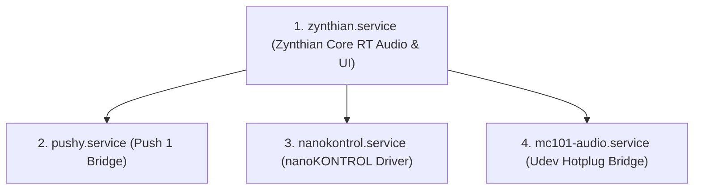

# Software Integration, Custom Plugins & Controller Driver Engineering Blueprint

Comprehensive software architecture, custom LV2 plugin development guide, controller driver specifications, and systemd orchestration blueprint for integrating the **Roland MC-101**, **Korg nanoKONTROL 1**, and **Ableton Push 1** into **ZynthianOS Vangelis**.

This document serves as the master software engineering specification for **Stage 2** and **Stage 3** of the [`mc-zynthian`](../README.md) roadmap.

---

## 1. Executive Architecture & Integration Strategy

In Stage 1, `mc-zynthian` establishes an autonomous synthesizer running on the Raspberry Pi 4, Blokas Pisound, Waveshare 5" touchscreen, and SayoDevice macro keyboard ([`docs/zynthian-guide.md`](zynthian-guide.md), [`docs/rpi-specs.md`](rpi-specs.md)). 

In Stages 2 and 3, the platform scales into a unified studio and live performance ecosystem. To prevent ad-hoc scripts or disconnected tools, all external hardware communicates through **standardized Zynthian extension mechanisms**:

```mermaid
flowchart TD
    subgraph ExternalHardware["External Hardware"]
        MC101["Roland MC-101\n(ZEN-Core 4-Track Synth/Sampler)"]
        NanoK["Korg nanoKONTROL 1\n(9 Faders, 9 Knobs, 18 Buttons, Transport)"]
        Push1["Ableton Push 1\n(64 RGB Pads, 8 Touch Encoders, LCD Display)"]
    end

    subgraph AudioAndMIDI["Audio & MIDI Driver Layer (ALSA / JACK2)"]
        ALSA_Audio["ALSA Vendor Mode\n(10 Capture / 4 Playback Channels @ 44.1kHz)"]
        JACK_Router["JACK2 Patchbay & Routing Matrix\n(PREEMPT_RT Real-Time Audio Server)"]
        ALSA_MIDI["ALSA Sequencer / MIDI Subsystem"]
    end

    subgraph SoftwareBridges["Custom Software Bridges & Drivers"]
        MC101_LV2["mc101-ctrl.lv2 (Custom LV2 Plugin)\nNative Parameter Controls, Pages & Snapshots"]
        MC101_Daemon["mcee-audio.sh (Daemon)\nAuto-Connection & Dynamic Stem Routing"]
        Nano_Driver["scripts/kontroller.py\n4-Scene State Machine & LED Feedback"]
        Push_Driver["scripts/pushy.py\nPad Scales, Step Sequencer, SysEx LCD Engine"]
    end

    subgraph ZynthianCore["ZynthianOS Vangelis Engine"]
        ZynUI["zynthian-ui (Control View / Launcher / Mixer)"]
        ZynCUIA["CUIA Command Engine (Port 1370)"]
        ZynChains["Dynamic Chains (Instruments / Audio FX / Mixbuses)"]
    end

    MC101 <-->|USB Audio (Vendor)| ALSA_Audio
    MC101 <-->|USB MIDI / SysEx| ALSA_MIDI
    NanoK <-->|USB MIDI CC / Notes| ALSA_MIDI
    Push1 <-->|USB MIDI / SysEx| ALSA_MIDI

    ALSA_Audio <--> MC101_Daemon
    MC101_Daemon <--> JACK_Router
    JACK_Router <--> ZynChains

    ALSA_MIDI <--> MC101_LV2
    MC101_LV2 <--> ZynChains
    MC101_LV2 <--> ZynUI

    ALSA_MIDI <--> Nano_Driver
    Nano_Driver <--> ZynCUIA
    Nano_Driver <--> ZynUI

    ALSA_MIDI <--> Push_Driver
    Push_Driver <--> ZynCUIA
    Push_Driver <--> ZynUI
```

### 1.1 Integration Architectural Matrix

| Device | Integration Goal | Optimal Software Architecture | Primary Protocol | Zynthian UI Integration |
|---|---|---|---|---|
| **Roland MC-101** | Deep ZEN-Core & Drum sound design | **Custom LV2 Plugin (`mc101-ctrl.lv2`)** | Roland SysEx DT1 (`0x12`) | Native parameter dials in **Control View**, full MIDI-Learn, automatic Snapshot preset saving |
| **Roland MC-101** | Multi-channel stem streaming & FX routing | **Background Daemon (`scripts/mcee-audio.sh`)** | ALSA Vendor Mode (`alsa_in` / `alsa_out`) | JACK audio ports auto-routed to Zynthian chains and Pisound inputs |
| **Korg nanoKONTROL 1** | Dedicated 8-channel mixer & transport control | **Python Driver (`scripts/kontroller.py`)** | MIDI CC & Notes + CUIA via OSC | Direct mixer fader tracking, bank scrolling, transport automation |
| **Ableton Push 1** | Melodic pads, drum step sequencing, LCD display | **Standalone Bridge (`scripts/pushy.py`) / Native ctrldev** | Push SysEx (LCD) + MIDI Notes + OSC | 64-pad scale matrix, 32-step sequencer, dual-page Zynthian parameter display |

---

## 2. Roland MC-101 LV2 Plugin Architecture (`mc101-ctrl.lv2`)

The user's preferred approach for controlling the Roland MC-101 from within Zynthian is a **dedicated LV2 plugin**. 

### 2.1 Why LV2 is the Gold Standard for Zynthian

Rather than running an external standalone script or web browser editor, an **LV2 (LADSPA Version 2) plugin** is hosted natively inside Zynthian by `jalv` and `mod-host`:
1. **Native UI Generation in Control View:** Zynthian parses the plugin's Turtle (`.ttl`) descriptor and automatically creates on-screen visual dials organized into logical parameter pages (Filter, Amp, LFO, MFX, Drum Kit).
2. **Physical Hardware Mapping:** Every LV2 control port automatically maps to the 4 physical rotary encoders and touch sliders without custom GUI code.
3. **Seamless MIDI-Learn:** Musicians can press Switch 3 (`o`) on any MC-101 parameter in Zynthian and turn any knob on the Korg nanoKONTROL or Ableton Push 1 to bind it immediately.
4. **Snapshot Persistence:** When a Zynthian Snapshot (preset) is saved, all LV2 control port values are serialized automatically. Loading a Snapshot instantly transmits the saved sound state back to the MC-101 via SysEx.
5. **Zero Latency & No Python GIL:** Written in standard C/C++, the plugin processes control updates in real time inside the audio thread without garbage collection pauses.

```
+---------------------------------------------------------------------------------+
|                       ZYNTHIAN CONTROL VIEW (mc101-ctrl.lv2)                    |
|                                                                                 |
|   [PAGE 1: ZEN-CORE FILTER]                  [PAGE 2: AMP ENVELOPE]             |
|   +------------------------------------+     +--------------------------------+ |
|   | Cutoff: 84 (2.4 kHz)  Resonance: 42|     | Attack: 12 ms   Decay: 340 ms  | |
|   | Type: TVF LPF         KeyFollow: +3|     | Sustain: 64     Release: 520 ms| |
|   +------------------------------------+     +--------------------------------+ |
|                                                                                 |
|   [PAGE 3: MULTI-EFFECTS (MFX)]              [PAGE 4: DRUM PAD EDIT]            |
|   +------------------------------------+     +--------------------------------+ |
|   | Type: 0x0014 (Tape Echo)           |     | Pad: 01 (Kick)   Pitch: +0 st  | |
|   | Time: 375 ms          Feedback: 65%|     | Coarse: +2       Decay: 180 ms | |
|   +------------------------------------+     +--------------------------------+ |
|                                                                                 |
|   [Encoder 1: Cutoff]   [Encoder 2: Res]     [Encoder 3: Type]   [Encoder 4: MFX|
+---------------------------------------------------------------------------------+
```

### 2.2 Plugin Bundle Structure

The plugin is structured as an LV2 bundle directory named `mc101-ctrl.lv2`:

```text
mc101-ctrl.lv2/
├── manifest.ttl          # Bundle manifest registering the plugin URI and binaries
├── mc101-ctrl.ttl        # Turtle descriptor: port definitions, pages, value ranges
└── mc101-ctrl.so         # Shared library compiled for ARM64 (Linux aarch64)
```

### 2.3 Turtle Descriptor (`mc101-ctrl.ttl`) Specification

The descriptor defines input control ports matching the Roland SysEx parameters documented in [`docs/mc101-sysex.md`](mc101-sysex.md):

```turtle
@prefix atom: <http://lv2plug.in/ns/ext/atom#> .
@prefix doap: <http://usefulinc.com/ns/doap#> .
@prefix lv2:  <http://lv2plug.in/ns/lv2core#> .
@prefix midi: <http://lv2plug.in/ns/ext/midi#> .
@prefix pg:   <http://lv2plug.in/ns/ext/port-groups#> .
@prefix rdf:  <http://www.w3.org/1999/02/22-rdf-syntax-ns#> .
@prefix rdfs: <http://www.w3.org/2000/01/rdf-schema#> .
@prefix urid: <http://lv2plug.in/ns/ext/urid#> .

<http://zynthian.org/plugins/mc101-ctrl>
    a lv2:Plugin, lv2:MIDIPlugin ;
    doap:name "Roland MC-101 Controller" ;
    doap:license <http://opensource.org/licenses/ISC> ;
    lv2:requiredFeature urid:map ;
    lv2:optionalFeature lv2:hardRTCapable ;

    # =========================================================================
    # MIDI / SysEx Stream Ports
    # =========================================================================
    lv2:port [
        a lv2:InputPort, atom:AtomPort ;
        atom:bufferType atom:Sequence ;
        atom:supports midi:MidiEvent ;
        lv2:index 0 ;
        lv2:symbol "midi_in" ;
        lv2:name "MIDI In"
    ] , [
        a lv2:OutputPort, atom:AtomPort ;
        atom:bufferType atom:Sequence ;
        atom:supports midi:MidiEvent ;
        lv2:index 1 ;
        lv2:symbol "midi_out" ;
        lv2:name "MIDI Out"
    ] ,

    # =========================================================================
    # Target Track Selector
    # =========================================================================
    [
        a lv2:InputPort, lv2:ControlPort ;
        lv2:index 2 ;
        lv2:symbol "track_select" ;
        lv2:name "Target Track" ;
        lv2:default 1 ;
        lv2:minimum 1 ;
        lv2:maximum 4 ;
        lv2:portProperty lv2:integer, lv2:enumeration ;
        lv2:scalePoint [ rdfs:label "Track 1" ; rdf:value 1 ] ;
        lv2:scalePoint [ rdfs:label "Track 2" ; rdf:value 2 ] ;
        lv2:scalePoint [ rdfs:label "Track 3" ; rdf:value 3 ] ;
        lv2:scalePoint [ rdfs:label "Track 4" ; rdf:value 4 ] ;
    ] ,

    # =========================================================================
    # Group: ZEN-Core Filter (Page 1)
    # =========================================================================
    [
        a lv2:InputPort, lv2:ControlPort ;
        lv2:index 3 ;
        lv2:symbol "cutoff" ;
        lv2:name "Filter Cutoff" ;
        lv2:default 512 ;
        lv2:minimum 0 ;
        lv2:maximum 1023 ;
        lv2:portProperty lv2:integer ;
    ] , [
        a lv2:InputPort, lv2:ControlPort ;
        lv2:index 4 ;
        lv2:symbol "resonance" ;
        lv2:name "Resonance" ;
        lv2:default 512 ;
        lv2:minimum 0 ;
        lv2:maximum 1023 ;
        lv2:portProperty lv2:integer ;
    ] , [
        a lv2:InputPort, lv2:ControlPort ;
        lv2:index 5 ;
        lv2:symbol "filter_type" ;
        lv2:name "Filter Mode" ;
        lv2:default 0 ;
        lv2:minimum 0 ;
        lv2:maximum 4 ;
        lv2:portProperty lv2:integer, lv2:enumeration ;
        lv2:scalePoint [ rdfs:label "Bypass" ; rdf:value 0 ] ;
        lv2:scalePoint [ rdfs:label "TVF LPF" ; rdf:value 1 ] ;
        lv2:scalePoint [ rdfs:label "TVF BPF" ; rdf:value 2 ] ;
        lv2:scalePoint [ rdfs:label "TVF HPF" ; rdf:value 3 ] ;
        lv2:scalePoint [ rdfs:label "TVF PKG" ; rdf:value 4 ] ;
    ] , [
        a lv2:InputPort, lv2:ControlPort ;
        lv2:index 6 ;
        lv2:symbol "filter_keyfollow" ;
        lv2:name "Cutoff Keyfollow" ;
        lv2:default 64 ;
        lv2:minimum 0 ;
        lv2:maximum 127 ;
        lv2:portProperty lv2:integer ;
    ] ,

    # =========================================================================
    # Group: Amp & Filter Envelopes (Page 2: Native 10-bit Resolution)
    # =========================================================================
    [
        a lv2:InputPort, lv2:ControlPort ;
        lv2:index 7 ;
        lv2:symbol "amp_attack" ;
        lv2:name "Amp Attack" ;
        lv2:default 0 ;
        lv2:minimum 0 ;
        lv2:maximum 1023 ;
        lv2:portProperty lv2:integer ;
    ] , [
        a lv2:InputPort, lv2:ControlPort ;
        lv2:index 8 ;
        lv2:symbol "amp_decay" ;
        lv2:name "Amp Decay" ;
        lv2:default 400 ;
        lv2:minimum 0 ;
        lv2:maximum 1023 ;
        lv2:portProperty lv2:integer ;
    ] , [
        a lv2:InputPort, lv2:ControlPort ;
        lv2:index 9 ;
        lv2:symbol "amp_sustain" ;
        lv2:name "Amp Sustain" ;
        lv2:default 1023 ;
        lv2:minimum 0 ;
        lv2:maximum 1023 ;
        lv2:portProperty lv2:integer ;
    ] , [
        a lv2:InputPort, lv2:ControlPort ;
        lv2:index 10 ;
        lv2:symbol "amp_release" ;
        lv2:name "Amp Release" ;
        lv2:default 400 ;
        lv2:minimum 0 ;
        lv2:maximum 1023 ;
        lv2:portProperty lv2:integer ;
    ] ,

    # =========================================================================
    # Group: Multi-Effects MFX (Page 3)
    # =========================================================================
    [
        a lv2:InputPort, lv2:ControlPort ;
        lv2:index 11 ;
        lv2:symbol "mfx_type" ;
        lv2:name "MFX Algorithm" ;
        lv2:default 0 ;
        lv2:minimum 0 ;
        lv2:maximum 90 ;
        lv2:portProperty lv2:integer ;
    ] , [
        a lv2:InputPort, lv2:ControlPort ;
        lv2:index 12 ;
        lv2:symbol "mfx_dry_wet" ;
        lv2:name "MFX Balance" ;
        lv2:default 64 ;
        lv2:minimum 0 ;
        lv2:maximum 127 ;
        lv2:portProperty lv2:integer ;
    ] ,

    # =========================================================================
    # Group: Drum Track Deep Editing (Page 4: KPTL Offsets)
    # =========================================================================
    [
        a lv2:InputPort, lv2:ControlPort ;
        lv2:index 13 ;
        lv2:symbol "drum_pad_select" ;
        lv2:name "Drum Pad (1-16)" ;
        lv2:default 1 ;
        lv2:minimum 1 ;
        lv2:maximum 16 ;
        lv2:portProperty lv2:integer ;
    ] , [
        a lv2:InputPort, lv2:ControlPort ;
        lv2:index 14 ;
        lv2:symbol "drum_level" ;
        lv2:name "Drum Key Level" ;
        lv2:default 100 ;
        lv2:minimum 0 ;
        lv2:maximum 127 ;
        lv2:portProperty lv2:integer ;
    ] , [
        a lv2:InputPort, lv2:ControlPort ;
        lv2:index 15 ;
        lv2:symbol "drum_cutoff_ofst" ;
        lv2:name "Drum Cutoff Offset" ;
        lv2:default 0 ;
        lv2:minimum -100 ;
        lv2:maximum 100 ;
        lv2:portProperty lv2:integer ;
    ] , [
        a lv2:InputPort, lv2:ControlPort ;
        lv2:index 16 ;
        lv2:symbol "drum_decay_ofst" ;
        lv2:name "Drum Decay Offset" ;
        lv2:default 0 ;
        lv2:minimum -100 ;
        lv2:maximum 100 ;
        lv2:portProperty lv2:integer ;
    ] .
```

### 2.4 Core C Implementation Architecture (`mc101_ctrl.c`)

The plugin monitors its input control ports. Whenever a control value changes (via encoder movement, touch drag, MIDI CC, or Snapshot recall), it formats and emits a Roland DT1 (`0x12`) SysEx message.

```c
#include <stdint.h>
#include <stdlib.h>
#include <string.h>
#include <lv2/core/lv2.h>
#include <lv2/atom/atom.h>
#include <lv2/atom/util.h>
#include <lv2/midi/midi.h>
#include <lv2/urid/urid.h>

#define MC101_PLUGIN_URI "http://zynthian.org/plugins/mc101-ctrl"
#define ROLAND_MANUFACTURER_ID 0x41
#define ROLAND_DEVICE_ID       0x10
#define ROLAND_MODEL_MC101     0x5E
#define ROLAND_CMD_DT1         0x12

typedef struct {
    LV2_URID atom_Sequence;
    LV2_URID midi_MidiEvent;
} MC101URIDs;

typedef struct {
    // Port buffers
    const LV2_Atom_Sequence* midi_in;
    LV2_Atom_Sequence*       midi_out;
    const float*             ports[17];

    // Shadow state to track value changes
    float last_values[17];

    // URID map
    LV2_URID_Map* map;
    MC101URIDs    urids;
} MC101Plugin;

// Calculate Roland 7-bit checksum over address + payload
static uint8_t roland_checksum(const uint8_t* data, size_t len) {
    uint32_t sum = 0;
    for (size_t i = 0; i < len; ++i) {
        sum += data[i];
    }
    return (uint8_t)((128 - (sum % 128)) % 128);
}

// Emit a standard Roland DT1 1-byte SysEx message into the output atom sequence
static void emit_sysex_dt1_byte(MC101Plugin* self, uint32_t address, uint8_t value) {
    uint8_t sysex_buf[14];
    sysex_buf[0]  = 0xF0; // SysEx Start
    sysex_buf[1]  = ROLAND_MANUFACTURER_ID;
    sysex_buf[2]  = ROLAND_DEVICE_ID;
    sysex_buf[3]  = 0x00;
    sysex_buf[4]  = 0x00;
    sysex_buf[5]  = 0x00;
    sysex_buf[6]  = ROLAND_MODEL_MC101;
    sysex_buf[7]  = ROLAND_CMD_DT1;

    // 4-byte 7-bit Address
    sysex_buf[8]  = (uint8_t)((address >> 21) & 0x7F);
    sysex_buf[9]  = (uint8_t)((address >> 14) & 0x7F);
    sysex_buf[10] = (uint8_t)((address >> 7)  & 0x7F);
    sysex_buf[11] = (uint8_t)(address & 0x7F);

    // 1-byte Payload
    sysex_buf[12] = value & 0x7F;

    // Checksum over address bytes (8..11) and payload (12)
    sysex_buf[13] = roland_checksum(&sysex_buf[8], 5);

    // End of Exclusive
    uint8_t final_frame[15];
    memcpy(final_frame, sysex_buf, 14);
    final_frame[14] = 0xF7;

    LV2_Atom_Event* ev = (LV2_Atom_Event*)lv2_atom_sequence_append(
        self->midi_out,
        sizeof(final_frame),
        self->urids.midi_MidiEvent
    );
    if (ev) {
        memcpy(LV2_ATOM_BODY(&ev->body), final_frame, sizeof(final_frame));
    }
}

// Emit a 2-nibble Roland DT1 SysEx message (for signed parameters with +128 offset: -100..+100 -> 28..228)
static void emit_sysex_dt1_nibbles2(MC101Plugin* self, uint32_t address, int16_t value) {
    uint8_t sysex_buf[15];
    sysex_buf[0]  = 0xF0;
    sysex_buf[1]  = ROLAND_MANUFACTURER_ID;
    sysex_buf[2]  = ROLAND_DEVICE_ID;
    sysex_buf[3]  = 0x00;
    sysex_buf[4]  = 0x00;
    sysex_buf[5]  = 0x00;
    sysex_buf[6]  = ROLAND_MODEL_MC101;
    sysex_buf[7]  = ROLAND_CMD_DT1;

    // 4-byte Address
    sysex_buf[8]  = (uint8_t)((address >> 21) & 0x7F);
    sysex_buf[9]  = (uint8_t)((address >> 14) & 0x7F);
    sysex_buf[10] = (uint8_t)((address >> 7)  & 0x7F);
    sysex_buf[11] = (uint8_t)(address & 0x7F);

    // 2-nibble payload with +128 offset
    uint16_t wire_val = (uint16_t)(value + 128);
    sysex_buf[12] = (uint8_t)((wire_val >> 4) & 0x0F);
    sysex_buf[13] = (uint8_t)(wire_val & 0x0F);

    // Checksum over address (8..11) and 2 payload bytes (12..13) = 6 bytes
    sysex_buf[14] = roland_checksum(&sysex_buf[8], 6);

    uint8_t final_frame[16];
    memcpy(final_frame, sysex_buf, 15);
    final_frame[15] = 0xF7;

    LV2_Atom_Event* ev = (LV2_Atom_Event*)lv2_atom_sequence_append(
        self->midi_out,
        sizeof(final_frame),
        self->urids.midi_MidiEvent
    );
    if (ev) {
        memcpy(LV2_ATOM_BODY(&ev->body), final_frame, sizeof(final_frame));
    }
}

// Track working buffer Slot 17 base addresses (Tracks 1 to 4)
static const uint32_t TONE_BASES[4] = { 0x30200000, 0x30420000, 0x30640000, 0x31060000 };

static void run(LV2_Handle instance, uint32_t sample_count) {
    MC101Plugin* self = (MC101Plugin*)instance;

    // Initialize MIDI output atom sequence buffer
    lv2_atom_sequence_clear(self->midi_out);

    uint8_t trk_idx = (uint8_t)(*self->ports[2]) - 1;
    if (trk_idx > 3) trk_idx = 0;
    uint32_t tone_base = TONE_BASES[trk_idx];

    // Check and transmit changed parameters
    // Port 3: Cutoff (PTL + 0x32, 4 nibbles)
    if (*self->ports[3] != self->last_values[3]) {
        self->last_values[3] = *self->ports[3];
        emit_sysex_dt1_nibbles4(self, tone_base + 0x00002032, (uint16_t)*self->ports[3]);
    }
    // Port 4: Resonance (PTL + 0x3D, 4 nibbles)
    if (*self->ports[4] != self->last_values[4]) {
        self->last_values[4] = *self->ports[4];
        emit_sysex_dt1_nibbles4(self, tone_base + 0x0000203D, (uint16_t)*self->ports[4]);
    }
    // Port 5: Filter Type (PTL + 0x31, 7-bit byte)
    if (*self->ports[5] != self->last_values[5]) {
        self->last_values[5] = *self->ports[5];
        emit_sysex_dt1_byte(self, tone_base + 0x00002031, (uint8_t)*self->ports[5]);
    }
    // Port 7..10: Amp Envelope Attack, Decay, Sustain, Release (AENV + 0x04/0x0C/0x1C/0x10, 4 nibbles)
    if (*self->ports[7] != self->last_values[7]) {
        self->last_values[7] = *self->ports[7];
        emit_sysex_dt1_nibbles4(self, tone_base + 0x00002C04, (uint16_t)*self->ports[7]);
    }
    if (*self->ports[8] != self->last_values[8]) {
        self->last_values[8] = *self->ports[8];
        emit_sysex_dt1_nibbles4(self, tone_base + 0x00002C0C, (uint16_t)*self->ports[8]);
    }
    if (*self->ports[9] != self->last_values[9]) {
        self->last_values[9] = *self->ports[9];
        emit_sysex_dt1_nibbles4(self, tone_base + 0x00002C1C, (uint16_t)*self->ports[9]);
    }
    if (*self->ports[10] != self->last_values[10]) {
        self->last_values[10] = *self->ports[10];
        emit_sysex_dt1_nibbles4(self, tone_base + 0x00002C10, (uint16_t)*self->ports[10]);
    }
}
```

### 2.5 Build and Deployment Instructions

To compile and register the plugin on the Zynthian system:

```bash
# 1. SSH into Zynthian
ssh root@zynthian.local

# 2. Clone/place plugin source in build directory
cd /zynthian/zynthian-plugins/
mkdir -p mc101-ctrl.lv2

# 3. Compile shared library
gcc -shared -fPIC -O3 -Wall \
    mc101_ctrl.c -o /zynthian/zynthian-plugins/mc101-ctrl.lv2/mc101-ctrl.so \
    $(pkg-config --cflags lv2)

# 4. Copy manifest and turtle files
cp manifest.ttl mc101-ctrl.ttl /zynthian/zynthian-plugins/mc101-ctrl.lv2/

# 5. Refresh Zynthian LV2 plugin registry cache
zynthian_lv2_cache.py
systemctl restart zynthian
```

---

## 3. Roland MC-101 Multi-Channel Audio Daemon (`scripts/mcee-audio.sh`)

In Vendor Mode, the MC-101 functions as a high-resolution, multi-channel USB 2.0 audio interface operating fixed at **$44.1\text{ kHz}$**:
- **10 Channels OUT (MC-101 $\to$ Pi):** 1+2 Master, 3+4 Track 1, 5+6 Track 2, 7+8 Track 3, 9+10 Track 4.
- **4 Channels IN (Pi $\to$ MC-101):** 1+2 Master In, 3+4 PC In (routes into MC-101 mixer).

> [!TIP]
> **Native Zynthian USB Audio Hotplug vs Custom Script:**
> Since Zynthian Oram and Vangelis, Zynthian includes native hotplugging for class-compliant USB audio devices using `zita-ajbridge` (`zita-a2j` / `zita-j2a`). Connected USB audio interfaces appear automatically in the Zynthian Audio Router. **Always check the native Zynthian Audio Router first**.
> If the native auto-bridge does not open all 10 capture / 4 playback channels for the MC-101, use the dedicated bridge daemon below. `zita-a2j` and `zita-j2a` provide lower CPU utilization and superior resampling drift compensation compared to legacy `alsa_in`/`alsa_out`, though `alsa_in`/`alsa_out` remains a proven fallback.
>
> **Sample Rate Policy:** Ensure Zynthian JACK is set to **$44100\text{ Hz}$** in Webconf so the bridge only tracks clock drift rather than performing CPU-intensive sample rate conversion.

```
+---------------------------------------------------------------------------------+
|                       MC-101 VENDOR AUDIO TRANSPORT PIPELINE                    |
|                                                                                 |
|  [Roland MC-101 USB Audio Class Interface (hw:MC101,DEV=0)]                     |
|           |                                             ^                       |
|           v (10 Channels Capture)                       | (4 Channels Playback) |
|  [zita-a2j -j MC101_in -d hw:MC101,DEV=0 -c 10]         |                       |
|  (or alsa_in -j MC101_in -r 44100 -p 64 -n 4 -c 10)     |                       |
|           |                                             |                       |
|           v                                             |                       |
|  [JACK2 Audio Server (44.1 kHz / 64 frames)]            |                       |
|      |               |               |                  |                       |
|      v (Track 1)     v (Track 2)     v (Master L/R)     |                       |
|  [Zynthian FX 1] [Zynthian FX 2] [Pisound Audio Out]    |                       |
|                                      |                  |                       |
|  [Pisound 1/4" Input (Synth/Mic)] ---+                  |                       |
|      |                                                  |                       |
|      +--------------------------------------------------+                       |
|             (zita-j2a -j MC101_out -d hw:MC101,DEV=0 -c 4)                      |
|             (or alsa_out -j MC101_out -r 44100 -p 64 -n 4 -c 4)                 |
+---------------------------------------------------------------------------------+
```

### 3.1 The Audio Daemon Script (`scripts/mcee-audio.sh`)

```bash
#!/usr/bin/env bash
# ==============================================================================
# mcee-audio.sh: Roland MC-101 Multi-Channel ALSA/JACK Bridge Daemon
# ==============================================================================

set -euo pipefail

ALSA_CARD="hw:MC101,DEV=0"
SAMPLE_RATE=44100
BUFFER_SIZE=64
PERIODS=4

cleanup() {
    echo "[MC-101 Audio] Stopping audio bridge daemons..."
    killall alsa_in alsa_out 2>/dev/null || true
    exit 0
}

trap cleanup SIGINT SIGTERM

echo "[MC-101 Audio] Waiting for MC-101 USB soundcard to enumerate..."
while ! grep -qi "MC101" /proc/asound/cards 2>/dev/null; do
    sleep 1
done

echo "[MC-101 Audio] Launching 10-channel capture bridge (alsa_in)..."
alsa_in -j "MC101_in" -d "$ALSA_CARD" -r "$SAMPLE_RATE" -p "$BUFFER_SIZE" -n "$PERIODS" -c 10 &

echo "[MC-101 Audio] Launching 4-channel playback bridge (alsa_out)..."
alsa_out -j "MC101_out" -d "$ALSA_CARD" -r "$SAMPLE_RATE" -p "$BUFFER_SIZE" -n "$PERIODS" -c 4 &

# Wait for JACK ports to register
sleep 2

echo "[MC-101 Audio] Patching JACK connections..."
# Route MC-101 Master Out to Pisound Main Stereo Playback
jack_connect "MC101_in:capture_1" "system:playback_1" || true
jack_connect "MC101_in:capture_2" "system:playback_2" || true

# Route Pisound Stereo Inputs into MC-101 PC Input (Channels 3 & 4)
jack_connect "system:capture_1" "MC101_out:playback_3" || true
jack_connect "system:capture_2" "MC101_out:playback_4" || true

echo "[MC-101 Audio] Audio routing active. Monitoring processes..."
wait
```

### 3.2 Udev Rule for Auto-Hotplug (`/etc/udev/rules.d/99-mc101.rules`)

```udev
# Roland MC-101 USB Audio / MIDI Hotplug Rule
SUBSYSTEM=="usb", ATTRS{idVendor}=="0582", ATTRS{idProduct}=="0248", TAG+="systemd", ENV{SYSTEMD_WANTS}="mc101-audio.service"
```

---

## 4. Korg nanoKONTROL 1 Controller Driver (`scripts/kontroller.py`)

The **Korg nanoKONTROL 1** provides 9 faders, 9 rotary knobs, 18 buttons, and 6 transport buttons across 4 hardware scenes ([`docs/nanokontrol-guide.md`](nanokontrol-guide.md)).

```
+---------------------------------------------------------------------------------+
|                       KORG NANOKONTROL 1 WORKSPACE MAPPING                      |
|                                                                                 |
|   [SCENE 1: ZYNTHIAN MIXER]                  [SCENE 2: SELECTED CHAIN FX]       |
|   Faders 1-8: Chains 1-8 Track Volume        Knobs 1-8: Selected Plugin Encoders|
|   Knobs 1-8:  Chains 1-8 Pan / Balance       Faders 1-8: 8 Macro Parameters     |
|   Upper Btn:  Solo Channel                   Upper Btn:  Bypass Insert FX       |
|   Lower Btn:  Mute Channel                   Lower Btn:  MIDI-Learn Parameter   |
|                                                                                 |
|   [SCENE 3: ROLAND MC-101 STEMS]             [SCENE 4: SEQUENCER & MASTER]      |
|   Faders 1-4: MC-101 Tracks 1-4 Level        Faders 1-8: Zynseq Velocity / Gate |
|   Knobs 1-4:  MC-101 Track Cutoffs           Knobs 1-8:  Master Compressor / EQ |
|   Upper Btn:  Scatter Pad Trigger            Transport:  CUIA Transport Engine  |
+---------------------------------------------------------------------------------+
```

### 4.1 Python Driver Architecture (`scripts/kontroller.py`)

The driver runs as a background service communicating with Zynthian's CUIA engine over UDP port `1370`:

```python
#!/usr/bin/env python3
"""
Korg nanoKONTROL 1 Controller Driver for Zynthian Vangelis
"""

import socket
import time
import mido

OSC_HOST = "127.0.0.1"
OSC_PORT = 1370

# CUIA Trigger Helper via UDP OSC
def send_cuia(action_name: str, param: str = ""):
    sock = socket.socket(socket.AF_INET, socket.SOCK_DGRAM)
    path = f"/cuia/{action_name}"
    # Standard OSC string formatting
    msg = path.encode("utf-8") + b"\x00"
    while len(msg) % 4 != 0:
        msg += b"\x00"
    if param:
        msg += b",s\x00\x00" + param.encode("utf-8") + b"\x00"
        while len(msg) % 4 != 0:
            msg += b"\x00"
    else:
        msg += b",\x00\x00\x00"
    sock.sendto(msg, (OSC_HOST, OSC_PORT))

class NanoKontrolDriver:
    def __init__(self, port_name: str = "nanoKONTROL"):
        self.port_name = port_name
        self.inport = None
        self.outport = None
        self.current_scene = 1

    def connect(self):
        print(f"[nanoKONTROL] Searching for port matching '{self.port_name}'...")
        for name in mido.get_input_names():
            if self.port_name in name:
                self.inport = mido.open_input(name)
                self.outport = mido.open_output(name)
                print(f"[nanoKONTROL] Connected to {name}")
                break

    def handle_transport(self, cc: int, val: int):
        if val == 0:
            return
        if cc == 44:  # Play
            send_cuia("TOGGLE_AUDIO_PLAY")
        elif cc == 45: # Stop
            send_cuia("TOGGLE_AUDIO_PLAY")
        elif cc == 46: # Rewind
            send_cuia("ARROW_UP")
        elif cc == 47: # Forward
            send_cuia("ARROW_DOWN")
        elif cc == 48: # Cycle / Loop -> Mixer screen
            send_cuia("SCREEN_AUDIO_MIXER")
        elif cc == 49: # Record
            send_cuia("TOGGLE_AUDIO_RECORD")

    def run(self):
        self.connect()
        if not self.inport:
            print("[nanoKONTROL] Device not found. Retrying in 5 seconds...")
            time.sleep(5)
            return

        print("[nanoKONTROL] Event processing loop active.")
        for msg in self.inport:
            if msg.type == "control_change":
                # Transport buttons
                if 44 <= msg.control <= 49:
                    self.handle_transport(msg.control, msg.value)

if __name__ == "__main__":
    driver = NanoKontrolDriver()
    while True:
        try:
            driver.run()
        except KeyboardInterrupt:
            break
        except Exception as e:
            print(f"[nanoKONTROL] Error: {e}")
            time.sleep(3)
```

### 4.2 Hardware LED Behavior on nanoKONTROL 1

> [!IMPORTANT]
> **No Host MIDI LED Control on nanoKONTROL Version 1:**
> On the first-generation nanoKONTROL (v1), button LEDs are **strictly local hardware indicators** wired directly to the physical button contact switches. The v1 firmware does **not** listen for incoming MIDI CC to change LED states (only the later nanoKONTROL2 added an "External LED mode").
> As such, software scripts must not attempt to send LED feedback loops over MIDI to a Version 1 device.

---

## 5. Ableton Push 1 Integration Architecture (`scripts/pushy.py`)

The foundation for Ableton Push 1 control is implemented in [`scripts/pushy.py`](../scripts/pushy.py).

### 5.1 Deployment Modes

Push 1 can be deployed into Zynthian Vangelis in one of two ways:
1. **Systemd Standalone Daemon (Recommended for Rapid Iteration):**
   Runs as a background daemon process communicating with Zynthian UI via OSC (`1370`) and ALSA MIDI.
2. **Native Zynthian Control Device (`zyngine/ctrldev/`):**
   Symlinked directly into `/zynthian/zynthian-ui/zyngine/ctrldev/zynthian_ctrldev_ableton_push1.py` so that Zynthian loads it internally upon UI startup.

### 5.2 LCD Display Text Protocol Integration

`scripts/pushy.py` renders four lines of 68-character text over the Push 1 LCD using the SysEx frame structure documented in [`docs/push-protocols.md`](push-protocols.md):

```text
Line 1: Track Names  [PIANOTEQ  ] [DEXED     ] [MC-101 T1 ] [MC-101 T2 ]
Line 2: Parameter    [Cutoff    ] [Resonance ] [ReverbSend] [Volume    ]
Line 3: Value Bar    [======|   ] [====|     ] [===|      ] [========| ]
Line 4: Status / BPM [120.0 BPM ] [4/4 Bar01 ] [SCENE: 01 ] [CPU: 22%  ]
```

---

## 6. System Orchestration, Systemd Units & Boot Sequence

To guarantee zero race conditions on boot, system components must start in a strict hierarchical order:



### 6.1 Systemd Service Unit: `nanokontrol.service`

Create `/etc/systemd/system/nanokontrol.service`:

```ini
[Unit]
Description=Korg nanoKONTROL 1 Zynthian Controller Bridge
After=zynthian.service
Wants=zynthian.service

[Service]
Type=simple
User=root
WorkingDirectory=/root
ExecStart=/usr/bin/python3 /zynthian/mc-zynthian/scripts/kontroller.py --daemon
Restart=always
RestartSec=3

[Install]
WantedBy=multi-user.target
```

### 6.2 Systemd Service Unit: `pushy.service`

Create `/etc/systemd/system/pushy.service`:

```ini
[Unit]
Description=Ableton Push 1 Zynthian Bridge Daemon (pushy.py)
After=zynthian.service
Wants=zynthian.service

[Service]
Type=simple
User=root
WorkingDirectory=/root
ExecStart=/usr/bin/python3 /zynthian/mc-zynthian/scripts/pushy.py --daemon
Restart=always
RestartSec=3

[Install]
WantedBy=multi-user.target
```

### 6.3 Systemd Service Unit: `mc101-audio.service`

Create `/etc/systemd/system/mc101-audio.service`:

```ini
[Unit]
Description=Roland MC-101 10-Out/4-In ALSA/JACK Audio Bridge
After=zynthian.service
Wants=zynthian.service

[Service]
Type=simple
User=root
WorkingDirectory=/root
ExecStart=/bin/bash /zynthian/mc-zynthian/scripts/mcee-audio.sh
Restart=on-failure
RestartSec=2

[Install]
WantedBy=multi-user.target
```

---

## 7. Implementation Roadmap & Development Milestones

```
+---------------------------------------------------------------------------------+
|                       DEVELOPMENT IMPLEMENTATION MILESTONES                     |
|                                                                                 |
|  MILESTONE 1 (Stage 2): MC-101 Audio Daemon & Multi-Channel JACK Patching       |
|  - Write and verify scripts/mcee-audio.sh                                       |
|  - Verify 10-channel ALSA capture & 4-channel playback with zero dropouts      |
|                                                                                 |
|  MILESTONE 2 (Stage 2): mc101-ctrl.lv2 Plugin Compilation & UI Verification     |
|  - Implement mc101_ctrl.c and mc101-ctrl.ttl                                    |
|  - Compile on Pi 4 and verify parameter display in Zynthian Control View       |
|  - Verify Roland DT1 SysEx transmission on filter/amp parameter adjustments     |
|                                                                                 |
|  MILESTONE 3 (Stage 2): Korg nanoKONTROL Bidirectional Driver                   |
|  - Implement scripts/kontroller.py                                              |
|  - Test 8-fader mixer tracking and transport CUIA triggers                      |
|  - Implement bidirectional LED illumination feedback                            |
|                                                                                 |
|  MILESTONE 4 (Stage 3): Ableton Push 1 Deployment & Daemonization               |
|  - Verify pushy.py daemonization via pushy.service                              |
|  - Confirm LCD parameter mirror of active Zynthian and MC-101 parameters        |
+---------------------------------------------------------------------------------+
```

### 7.1 Cross-Document References

- **Master OS Architecture:** [`docs/zynthian-guide.md`](zynthian-guide.md)
- **Hardware Platform & Enclosure:** [`docs/rpi-specs.md`](rpi-specs.md)
- **Roland MC-101 Hardware & SysEx Details:** [`docs/mc101-guide.md`](mc101-guide.md) & [`docs/mc101-sysex.md`](mc101-sysex.md)
- **Korg nanoKONTROL Hardware Specs:** [`docs/nanokontrol-guide.md`](nanokontrol-guide.md)
- **Ableton Push 1 Hardware & Protocols:** [`docs/push-guide.md`](push-guide.md), [`docs/push-protocols.md`](push-protocols.md), and [`scripts/pushy.py`](../scripts/pushy.py)

