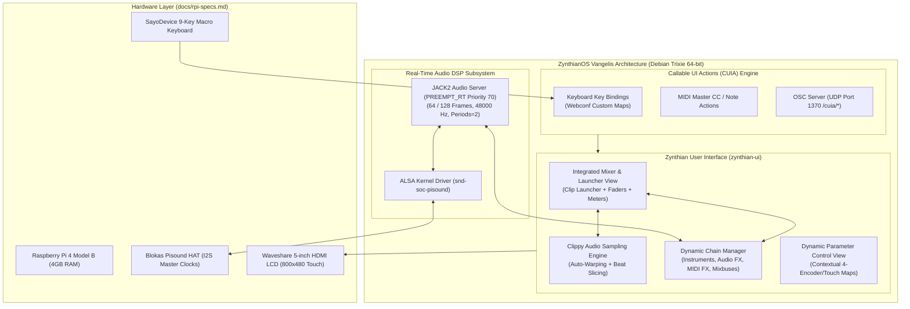

# Zynthian Vangelis OS: Architecture, Low-Latency Configuration & Operations Bible

Comprehensive operating system manual, ultra-low-latency audio tuning guide, CUIA command reference, and operations handbook for **ZynthianOS Vangelis** (Stable 2610 / Debian Trixie 64-bit).

This document serves as the master operating system foundation for the entire [`mc-zynthian`](../README.md) project. Built on top of the custom hardware stack ([`docs/rpi-specs.md`](rpi-specs.md)), this manual details how to install, configure, operate, and troubleshoot Zynthian Vangelis for mission-critical, ultra-low-latency electronic music performance.

---

## 1. Executive Overview & The Vangelis Paradigm

**ZynthianOS Vangelis** (released as Stable 2610 in October 2026, succeeding *Oram*) represents a monumental architectural leap for the open-source Zynthian music platform. Built upon **Debian Trixie (64-bit)** with an active real-time kernel (`PREEMPT_RT`), Vangelis transforms Zynthian from a multi-engine sound module into an autonomous, all-in-one groovebox, live clip launcher, multi-track audio workstation, and MIDI routing powerhouse.



### 1.1 Architectural Breakthroughs in Vangelis

| Feature | Legacy Zynthian (V4 / Oram) | Zynthian Vangelis (Stable 2610) | Impact on `mc-zynthian` Project |
|---|---|---|---|
| **Base OS** | Debian Bookworm / Bullseye | **Debian Trixie (64-bit)** | Modern toolchains, updated ALSA/JACK2, enhanced multi-core CPU scheduling |
| **Clip Launching** | Separate *Zynpad* view | **Integrated Mixer & Launcher View** | Clip triggering and mixer faders/meters coexist on one unified screen |
| **Audio Sampling** | Zynsampler (basic playback) | **Clippy Engine** | Real-time auto-warping (time-stretching to project BPM), transient slicing, loop cropping |
| **Phrase Automation** | Manual pattern switching | **Automated Phrases (Scenes)** | Rows trigger synchronized clips with automatic progression after $N$ bars |
| **Chain Topology** | Fixed slot indexing | **Dynamic Drag-and-Drop Chains** | Reorder chains, pin to right (master/sends), insert sub-mixbuses (blue strips) |
| **Expressive MIDI** | Standard 7-bit MIDI | **Native MPE Support** | Multi-channel per-note pitch bend, pressure, and timbre across supported synths |
| **Remote Control** | Fragmented command sets | **Universal CUIA Architecture** | 100% UI automation via USB keyboard, MIDI master triggers, and OSC network |

---

## 2. Installation, Deployment & Initial Setup

To achieve rock-solid performance, deploy the official stable Vangelis release image onto high-speed media.

### 2.1 Image Acquisition & Flashing

1. **Download Official Image:**
   - Download the official stable image: `2026-10-15-zynthianos-vangelis-2610-stable.img.xz` from [zynthian.org](https://zynthian.org).
2. **Flash Storage Media:**
   - Use **Raspberry Pi Imager** or **BalenaEtcher** to flash the `.img.xz` file directly onto an **A2 / V30 / U3 MicroSDXC card** (e.g., SanDisk Extreme 64GB) or high-speed USB 3.0 SSD.
   - *Do not apply custom OS customization scripts in Raspberry Pi Imager* (e.g., do not set custom usernames or pre-populate Wi-Fi configs through the tool, as Zynthian initializes its own system accounts and services on first boot).
3. **First Boot Initialization:**
   - Insert the MicroSD card into the Raspberry Pi 4 Model B, connect the Waveshare 5" HDMI display, plug in the Blokas Pisound, and connect the official 5.1V / 3.0A USB-C power supply.
   - On the very first boot, Zynthian runs an automated expansion sequence:
     - Automatically expands the root filesystem partition across the entire storage capacity.
     - Generates unique SSH host keys.
     - Starts `jackd2` and the `zynthian-ui` service.
     - The first boot takes approximately 90 to 120 seconds. The screen will reboot once or twice before displaying the default Zynthian boot logo and launching into the Main Mixer screen.

### 2.2 Default System Credentials & Network Access

- **Hostname:** `zynthian.local` (resolves automatically via mDNS / Avahi)
- **Webconf Dashboard:** `http://zynthian.local` (or `http://<IP-ADDRESS>`)
- **Webconf Default Password:** `raspberry`
- **SSH Terminal Access:**
  ```bash
  ssh root@zynthian.local
  # Password: raspberry
  ```

---

## 3. Webconf Configuration for DIY Hardware (Pisound + 5" LCD)

Because `mc-zynthian` is a custom DIY build rather than an official Zynthian V4 or V5 kit, the hardware profiles must be explicitly configured through the **Zynthian Web Configuration Tool (Webconf)**.

```
+---------------------------------------------------------------------------------+
|                       ZYNTHIAN WEBCONF DASHBOARD                                |
|                                                                                 |
|   [Hardware]     [Software]     [Interface]     [Audio]     [MIDI]     [System] |
|       |                                                                         |
|       +---> Kit: Custom / None                                                  |
|       +---> Audio: Blokas Pisound (snd-soc-pisound)                             |
|       +---> Display: Custom HDMI (800x480 @ 60Hz)                               |
|       +---> Wiring: Custom GPIO (GPIO 17 -> The Button)                         |
+---------------------------------------------------------------------------------+
```

### 3.1 Step-by-Step Webconf Setup

1. Open your browser and navigate to `http://zynthian.local`.
2. Authenticate using the password `raspberry`.
3. Configure the hardware subsystems as outlined below:

#### A. Hardware -> Kit
- **Kit Profile:** Select **`Custom`** (or **`None`**).
- *Rationale:* Disables the auto-detection routines meant for proprietary V4/V5 MCP23017 I2C port expanders, preventing bus timeout warnings.

#### B. Hardware -> Audio
- **Soundcard:** Select **`Blokas Pisound`**.
- This applies the kernel device tree overlay `dtoverlay=pisound` to `/boot/firmware/config.txt`, initializing the TI PCM5102A DAC and TI PCM1804 ADC in I2S Master Clock mode.
- Sets the ALSA hardware device identifier to `hw:pisound`.

#### C. Hardware -> Display
- **Display Type:** Select **`Generic HDMI Display`** (or **`Custom HDMI`**).
- Set display resolution: **Width: 800**, **Height: 480**.
- **KMS Video Timing:** Modern ZynthianOS (Oram / Vangelis on Debian Bookworm / Trixie) uses the standard Linux kernel **KMS (Kernel Mode Setting)** graphics driver (`dtoverlay=vc4-kms-v3d`). Under KMS, legacy `hdmi_cvt`, `hdmi_group`, and `hdmi_mode` lines in `config.txt` are ignored.
- The Waveshare 5-inch HDMI LCD (H) provides standard EDID over the HDMI DDC line and negotiates $800 \times 480 @ 60\text{ Hz}$ automatically. If a video mode must be manually forced, append the following parameter to the single line in `/boot/firmware/cmdline.txt`:
  ```text
  video=HDMI-A-1:800x480M@60
  ```
- To verify the active KMS mode from SSH:
  ```bash
  cat /sys/class/drm/card*-HDMI-A-1/modes
  ```

#### D. Hardware -> Wiring
- **Wiring Profile:** Select **`Custom`**.
- **Encoders:** Set to `0` or configure GPIO numbers if external rotary encoders are added later.
- **Switches:** Map GPIO 17 to **Switch 1** (or assign to The Button via `pisound-btn` daemon, see [`docs/pisound-guide.md`](pisound-guide.md)).

#### E. Save and Reboot
- Click **Save** at the bottom of the Webconf screen.
- Go to **System -> Reboot** to commit all kernel overlays and hardware bindings.

---

## 4. Audio Engine Architecture & Ultra-Low Latency Optimization

To deliver instant response for live playing, Zynthian Vangelis pairs the **Linux `PREEMPT_RT` real-time kernel** with the **JACK2 (`jackd`) audio server**.

```
+---------------------------------------------------------------------------------+
|                       JACK2 AUDIO PIPELINE (RT PRIORITY 70)                     |
|                                                                                 |
|  [Hardware: Pisound Dual Oscillators (22.5792 / 24.5760 MHz)]                   |
|                                |                                                |
|                                v                                                |
|  [ALSA Kernel Ring Buffer: snd-soc-pisound]                                     |
|                                |                                                |
|                                v (Frames: 64, Rate: 48000Hz, Periods: 2)        |
|  [JACK2 Audio Server Engine]   +---> Real-Time Deadline: 1.333 ms               |
|                                |                                                |
|                                v                                                |
|  [Zynthian Audio Router / Matrix]                                               |
|        |                       |                       |                        |
|        v                       v                       v                        |
|  [Instrument Chains]    [Audio FX Chains]      [Mixbus / Master Fader]          |
|  (Pianoteq/Dexed/Surge) (Reverbs/Delays/MOD)   (Stereo 1/4" Out & Headphones)   |
+---------------------------------------------------------------------------------+
```

### 4.1 Audio Latency Mathematics & Buffer Calculation

In real-time audio systems, latency is governed by buffer frame size ($F$), buffer periods ($n$), and sample rate ($R_\text{s}$):
- **Period Processing Deadline ($T_\text{deadline}$):** The time window in which the CPU must complete synthesis calculations for one block:
  $$T_\text{deadline} = \frac{F}{R_\text{s}} = \frac{64}{48000\text{ Hz}} \approx 1.333\text{ ms}$$
- **Output Buffer Latency:** Delay between DSP generation and DAC conversion ($n \times F / R_\text{s}$, giving $2.67\text{ ms}$ at 64 samples / 2 periods / 48 kHz).
- **Approximate Round-Trip Latency:** Including ADC capture buffers, scheduling, DAC buffers, and converter group delay ($\approx 1\text{ ms}$ for Pisound's PCM1804 + PCM5102A):
  $$\text{Latency}_\text{round-trip} \approx \frac{(n + 1) \times F}{R_\text{s}} + \text{Converter Delay} \approx \frac{3 \times 64}{48000} + 1.0\text{ ms} \approx 5.0\text{ ms}$$
  *(For in-depth mathematical derivations and `jack_iodelay` measurement procedures, see [`docs/pisound-guide.md`](pisound-guide.md#3-low-latency-performance--audio-optimization)).*

| Buffer Size ($F$) | Periods ($n$) | Sample Rate ($R_\text{s}$) | Process Deadline | Output Latency | Approx. Round-Trip | Recommended Use Case |
|---|---|---|---|---|---|---|
| **64 frames** | **2** | **$48000\text{ Hz}$** | **$1.33\text{ ms}$** | **$2.67\text{ ms}$** | **$\approx 5.0\text{ ms}$** | **Stage 1 Baseline:** Ultra-fast synth response, finger-drumming |
| **128 frames** | **2** | **$48000\text{ Hz}$** | **$2.67\text{ ms}$** | **$5.33\text{ ms}$** | **$\approx 9.0\text{ ms}$** | **Stage 1 Complex:** Heavy polyphony, Pianoteq, multiple synth layers |
| **64 frames** | **2** | **$44100\text{ Hz}$** | **$1.45\text{ ms}$** | **$2.90\text{ ms}$** | **$\approx 5.5\text{ ms}$** | **Stage 2 & 3 Standard:** Optimal sync with MC-101 and Teensy (zero resampling) |
| **128 frames** | **2** | **$44100\text{ Hz}$** | **$2.90\text{ ms}$** | **$5.80\text{ ms}$** | **$\approx 9.8\text{ ms}$** | **Stage 2 & 3 Heavy:** Multitrack streaming + external USB bridges |

### 4.2 Webconf Audio Latency Tuning

Navigate to **Webconf -> Audio -> Options**:
- **Sample Rate:** `48000` (or `44100` if interfacing with Roland MC-101 vendor mode).
- **Buffer Size:** `64` (for live performance) or `128` (for complex arrangements).
- **Number of Periods:** `2` (standard for I2S soundcards like Pisound).
- **Soft Mode / Mask XRUNs:** `Disabled` (ensures accurate reporting of any processing overruns).

### 4.3 Operating System Tuning for Zero-XRUN Performance

To ensure real-time audio threads are never interrupted by kernel power-saving state transitions:

1. **Lock CPU Governor to Maximum Performance:**
   Ensure the CPU frequency governor is set to `performance` rather than `ondemand`:
   ```bash
   echo "performance" | tee /sys/devices/system/cpu/cpu*/cpufreq/scaling_governor
   ```
   *To make this permanent on boot, add `GOVERNOR="performance"` in `/etc/default/cpufrequtils`.*

2. **Disable Memory Swapping:**
   On a 4GB Raspberry Pi 4 running Zynthian, RAM is plentiful. Disk swapping to a MicroSD card introduces severe I/O latency stalls that cause immediate audio dropouts:
   ```bash
   dphys-swapfile swapoff
   dphys-swapfile uninstall
   systemctl disable dphys-swapfile
   ```

3. **Verify Thread Priority:**
   The JACK server runs at real-time priority `70`. Audio client threads (Pianoteq, Fluidsynth, Surge-XT) inherit real-time scheduling:
   ```bash
   ps -eLo pid,rtprio,comm | grep -E "jackd|zynthian"
   ```

---

## 5. UI Navigation & The Four-Encoder / Switch Paradigm

The Zynthian interface is conceptually built around a quadrant of **4 rotary encoders** with integrated **push switches**:

```
+-------------------------------------------------------------+
| [Encoder 1 / Switch 1]             [Encoder 3 / Switch 3]   |
| (Top Left: Layer / Back)           (Top Right: Learn / Snap)|
|                                                             |
|                      ZYNTHIAN DISPLAY                       |
|                                                             |
| [Encoder 2 / Switch 2]             [Encoder 4 / Switch 4]   |
| (Bottom Left: Back / Cancel)       (Bottom Right: Select)   |
+-------------------------------------------------------------+
```

### 5.1 Push Switch Timing Behaviors

Zynthian distinguishes between three switch press durations:
1. **Short Push ($< 0.3\text{ seconds}$):** Standard selection, entering submenus, toggling parameters.
2. **Bold Push ($0.3\text{ to } 2.0\text{ seconds}$):** Contextual actions, opening chain options, toggling mixer views.
3. **Long Push ($> 2.0\text{ seconds}$):** Administrative actions, opening main menu, powering off.

### 5.2 Emulating Encoders and Switches via Keyboard (Key Bindings)

Under **Webconf -> Interface -> UI Key Binding**, Zynthian provides full keyboard emulation of all physical controls:

#### Encoder Rotation:
- **`,` (Comma / `<`):** Counter-Clockwise (Decrement value / scroll up)
- **`.` (Period / `>`):** Clockwise (Increment value / scroll down)
- **Modifiers:**
  - *No Modifier:* Operates **Encoder 4** (Bottom-Right / Primary Select)
  - *Ctrl Modifier:* Operates **Encoder 2 / 1** (Left encoders)
  - *Shift Modifier:* Operates **Encoder 3 / 1** (Top encoders)

#### Switches:
- **`i`:** Switch 1 (Top Left / Layer)
- **`k`:** Switch 2 (Bottom Left / Back)
- **`o`:** Switch 3 (Top Right / Learn & Snapshot)
- **`l`:** Switch 4 (Bottom Right / Select)

### 5.3 Stage 1 Physical Integration: SayoDevice 12-Key Macro Keyboard

Our hardware build integrates the [SayoDevice Macro Keyboard](macrokeyboard-guide.md) configured into a 9-key retro controller layout. The keys map directly to Zynthian navigation as follows:

```
+---------------------------------------------------------------------------------------------------------------------------------------+
|  [ Key 1: HIDDEN ]   [ Key 2: UP ]       [ Key 3: HIDDEN ]   [ Key 4: SHIFT ]       [ Key 5: A ]            [ Key 6: B ]              |
|  (Internal/Masked)   (D-Pad Up)          (Internal/Masked)   (Layer Modifier)       (Action A / Select)     (Action B / Back)         |
|                                                                                                                                       |
|  [ Key 7: LEFT ]     [ Key 8: DOWN ]     [ Key 9: RIGHT ]    [ Key 10: HIDDEN ]     [ Key 11: SELECT ]      [ Key 12: START ]         |
|  (D-Pad Left)        (D-Pad Down)        (D-Pad Right)       (Internal/Masked)      (Screen / Menu / Enter) (Transport / Spacebar)    |
+---------------------------------------------------------------------------------------------------------------------------------------+
```

- **`UP` / `DOWN` (Keys 2 & 8):** Vertical list scrolling and fader level adjustments.
- **`LEFT` / `RIGHT` (Keys 7 & 9):** Channel strip traversal and parameter page switching.
- **`A` (Key 5):** Primary Select / Confirm (equivalent to Switch 4 Short Push / `Enter`).
- **`B` (Key 6):** Back / Exit (equivalent to Switch 2 Short Push / `Escape`).
- **`SELECT` (Key 11):** Toggles between Main Mixer, Launcher, and Control views (`Tab`).
- **`START` (Key 12):** Global Transport Play / Stop (`Spacebar`).
- **`SHIFT + Key`:** Contextual actions (Chain Options via Bold Select, Snapshot Browser, Audio Routing Matrix).

---

## 6. Callable UI Actions (CUIA) Complete Reference Manual

**Callable UI Actions (CUIA)** provide a unified command API enabling remote and scripted control over the Zynthian user interface.

### 6.1 Invocation Channels

CUIAs can be invoked across three primary channels:
1. **USB Keyboard Key Bindings:** Configured under **Webconf -> Interface -> UI Key Binding**. You can map any connected physical keyboard key (including the SayoDevice macro keyboard) to any CUIA action.
2. **MIDI Master Triggers:** Configured under **Webconf -> Interface -> MIDI Key Binding / Master Channel** to trigger CUIAs from MIDI Notes, Program Changes, or CC messages.
3. **Network OSC Commands:** Sent over UDP to **Port `1370`** using the `/cuia/` path prefix (case-insensitive):
   ```bash
   # Example: Toggle audio playback over OSC
   oscsend 127.0.0.1 1370 /cuia/TOGGLE_AUDIO_PLAY

   # Example: Navigate to the mixer screen
   oscsend 127.0.0.1 1370 /cuia/SCREEN_AUDIO_MIXER

   # Example: Emergency MIDI Panic
   oscsend 127.0.0.1 1370 /cuia/ALL_NOTES_OFF
   ```

> [!NOTE]
> **Verifying Live CUIA Names in Webconf:**
> Because Zynthian Vangelis continuously refines and expands its action set, the definitive list of available CUIAs for your installed build is always visible in **Webconf -> Interface -> UI Key Binding** (dropdown list) and **Interface -> MIDI Key Binding**.

### 6.2 Verified Canonical CUIA Command Matrix

#### Screen & View Switching
| CUIA Command | Function / Screen Target | Notes |
|---|---|---|
| **`SCREEN_MAIN_MENU`** | Open main configuration & system menu | Master navigation home |
| **`SCREEN_AUDIO_MIXER`** | Switch display to Main Audio Mixer / Clip Launcher | Primary performance screen |
| **`SCREEN_ZYNPAD`** | Switch display to Clip / Pattern Launcher | Note: Integrated into mixer in Vangelis |
| **`SCREEN_ADMIN`** | Jump directly to Admin / Settings screen | Wi-Fi, audio levels, system info |
| **`SCREEN_SNAPSHOT`** | Open Snapshot / Bank recall browser | Instant state switching |
| **`SCREEN_PATTERN_EDITOR`**| Open Step Sequencer / Pattern Editor view | Direct grid pattern editing |

#### Navigation & Selection
| CUIA Command | Function / Direction | Notes |
|---|---|---|
| **`ARROW_UP`** | Cursor Up / List Scroll Up | D-Pad Up |
| **`ARROW_DOWN`** | Cursor Down / List Scroll Down | D-Pad Down |
| **`ARROW_LEFT`** | Cursor Left / Previous Channel Strip | D-Pad Left |
| **`ARROW_RIGHT`** | Cursor Right / Next Channel Strip | D-Pad Right |
| **`SELECT`** | Confirm / Enter / Activate highlighted element | Primary Action A |
| **`BACK`** | Return to previous menu level / Cancel | Primary Action B |
| **`ZYNSWITCH <idx> <act>`**| Emulate hardware switch event directly | Args: switch index ($0..3$) + action (`S`=Short, `B`=Bold, `L`=Long, `P`=Press, `R`=Release) |

#### Transport & Audio Capture
| CUIA Command | Behavior | Notes |
|---|---|---|
| **`TOGGLE_AUDIO_PLAY`** | Toggle global audio playback / stop | Audio transport |
| **`TOGGLE_MIDI_PLAY`** | Toggle sequencer / MIDI pattern playback | Sequencer transport |
| **`TOGGLE_AUDIO_RECORD`**| Arm / Toggle stereo master WAV recording | Records to internal storage |

#### Emergency & System Management
| CUIA Command | Function Description | Notes |
|---|---|---|
| **`ALL_NOTES_OFF`** | **MIDI Panic:** Send All Notes Off across all channels | Essential live failsafe |
| **`ALL_SOUNDS_OFF`** | Hard silence all active DSP synthesis engines | Emergency mute |
| **`RESTART_UI`** | Gracefully restart the `zynthian-ui` process | Useful after config changes |
| **`REBOOT`** | Safely reboot the operating system | Flushes buffers to disk |
| **`POWER_OFF`** | Safely power down the system | Clean shutdown before power cut |

---

## 7. Vangelis Core Views & Daily Operations

Zynthian Vangelis organizes music production and performance into three interrelated views.

```
+---------------------------------------------------------------------------------+
|                       MAIN MIXER & LAUNCHER VIEW                                |
|                                                                                 |
|   [Top Bar: 120.0 BPM | 4/4 | Bar 001.1 | CPU 18% | RAM 22% | Temp 46°C]        |
|  +--------------------+--------------------+--------------------+------------+  |
|  | CH 1: PIANOTEQ     | CH 2: DEXED        | CH 3: CLIPPY       | MASTER     |  |
|  | (Acoustic Grand)   | (FM Bass)          | (Drums 120)        | MAIN OUT   |  |
|  +--------------------+--------------------+--------------------+------------+  |
|  | [Pattern 1: Intro] | [Pattern 1: Bass1] | [Clip 1: BeatA]    | [PHRASE 1] |  |
|  | [Pattern 2: Verse] | [Pattern 2: Bass2] | [Clip 2: BeatB]    | [PHRASE 2] |  |
|  | [Pattern 3: Solo]  | [Pattern 3: Fill]  | [Clip 3: Break]    | [PHRASE 3] |  |
|  +--------------------+--------------------+--------------------+------------+  |
|  | MUTE | SOLO        | MUTE | SOLO        | MUTE | SOLO        | MUTE       |  |
|  | BAL: < C >         | BAL: < C >         | BAL: < C >         | BAL: < C > |  |
|  | VOL: [====|   ]    | VOL: [======| ]    | VOL: [=====|  ]    | [=======|] |  |
|  | -6.2 dB            | -3.1 dB            | -4.5 dB            | 0.0 dB     |  |
+--+--------------------+--------------------+--------------------+------------+--+
```

### 7.1 Main Mixer & Launcher View

In Vangelis, the clip/pattern launcher is no longer a separate application—it is integrated directly into the channel strips of the **Main Mixer**:
- **Vertical Columns (Chains):** Each column represents an active sound generator, audio input, or effect processor.
- **Mixer Controls:** The bottom half of each column features real-time faders, pan/balance indicators, mute/solo toggles, and multi-segment peak audio meters.
- **Launcher Cells (Clips):** The upper half displays stacked launcher slots. A slot can contain either a **MIDI Sequence** (powered by `zynseq`) or an **Audio Sample Clip** (powered by `Clippy`).
- **Horizontal Rows (Phrases):** A horizontal row across all columns forms a **Phrase** (analogous to an Ableton Live Scene). Tapping a Phrase launch button synchronously triggers the corresponding clips across all chains.
- **Phrase Automation:** Phrases can be configured with an automatic bar counter (e.g., play Phrase 1 for 8 bars, then smoothly transition into Phrase 2).

### 7.2 The Clippy Audio Clip & Sampler Engine

**Clippy** is Vangelis's native audio-clip playback and manipulation engine:
- **Auto-Warping:** When an audio loop is loaded (e.g., drum breaks or vocal stems), Clippy analyzes transient markers and automatically time-stretches the sample to sync with the global project BPM without altering pitch.
- **Beat Slicing:** Automatically slices rhythmic audio into individual hits, allowing them to be triggered via MIDI pads or sequenced by Zynseq.
- **Loop Cropping:** Easily adjust start, end, and crossfade loop points directly from the screen using the encoders or touch drag gestures.

### 7.3 Dynamic Chain Management

Chains in Vangelis are dynamic and modular:
- **Instrument Chains:** Synthesizer engines (Pianoteq, Surge-XT, Dexed, Fluidsynth, OB-Xd, Monosynth).
- **Audio FX Chains:** Insert or aux send/return effects (reverbs, delays, choruses, amp simulators, MOD-UI LV2 plugins).
- **MIDI FX Chains:** Arpeggiators, MIDI chord generators, transpose filters, velocity curves.
- **Special Chains:** Pure Data patches, Sooperlooper multi-track looper, Audio In line-level pass-through from Pisound.
- **Mixbuses (Submixes):** Highlighted with blue legend strips. Channels can be routed into submixes before hitting the Master Mixbus (marked with a dark red legend strip).
- **Reordering & Pinning:** Chains can be moved laterally or pinned to the right side of the screen (keeping master faders and FX returns permanently visible).

### 7.4 Control View (Parameter Editing)

Entering the **Control View** maps the 4 physical rotary encoders (or keyboard arrows) to the active plugin's synthesis parameters:
- Displays parameter names, numerical values, and graphical dials.
- Supports paging: Use `Next Page` / `Previous Page` to navigate through deep multi-page engines (e.g., filter cutoff, resonance, envelopes, LFOs).
- **MIDI Learn:** Pressing Switch 3 (`o`) instantly arms the highlighted parameter for MIDI-Learn. Simply move a physical knob or fader on the Korg nanoKONTROL to bind it immediately.

### 7.5 Snapshots System (State Management)

Zynthian saves its entire operational state into **Snapshots**:
- A snapshot preserves active sound engines, loaded soundfonts, audio/MIDI routing matrix configurations, mixer volumes, loaded clips, sequences, and tempo.
- **Bank / Preset Hierarchy:** Snapshots are organized into Banks for different songs, projects, or live sets.
- **Instant Recall:** Recalling a snapshot takes between 0.5s and 2s, enabling seamless live transitions between musical pieces.

---

## 8. Troubleshooting, Diagnostics & Maintenance

When configuring DIY hardware or operating in high-pressure performance venues, use these diagnostic procedures to verify system health.

```
+---------------------------------------------------------------------------------+
|                       DIAGNOSTIC VERIFICATION MATRIX                            |
|                                                                                 |
|  [Hardware Check: Pisound ALSA Cards & GPIO] ---> aplay -l / arecord -l         |
|  [Audio Pipeline: JACK2 Processing Load]    ---> jack_cpu_load / jack_lsp       |
|  [Thermal & Voltage: Throttling Bitmask]    ---> vcgencmd get_throttled         |
|  [UI System Health: Systemd Journal Logs]   ---> journalctl -u zynthian -f      |
+---------------------------------------------------------------------------------+
```

### 8.1 Diagnostic Terminal Commands

```bash
# 1. Verify soundcard detection in ALSA
aplay -l
arecord -l
# Expected: card 0 [pisound]: snd_soc_pisound

# 2. Check live JACK audio server CPU load and XRUN count
jack_cpu_load

# 3. List all registered JACK audio and MIDI client ports
jack_lsp -c

# 4. Check hardware thermal temperature and throttling events
vcgencmd measure_temp
vcgencmd get_throttled
# Expected: throttled=0x0 (no under-voltage or thermal capping)

# 5. Monitor live Zynthian UI debug logs
journalctl -u zynthian -f

# 6. List all connected ALSA MIDI hardware ports and sequencer clients
aconnect -l
```

### 8.2 Common Faults & Resolution Matrix

| Symptom | Root Cause | Immediate Diagnostic / Resolution |
|---|---|---|
| **No audio output from Pisound** | ALSA mixer attenuated, or soundcard not selected in Webconf | Check `Hardware -> Audio` is set to `Blokas Pisound`. Check analog volume pot on Pisound. Run `alsamixer -c pisound` and ensure outputs are unmuted. |
| **Frequent Audio XRUNs / pops** | Buffer size too small ($< 64$), CPU throttling, or heavy synth load | Check `vcgencmd get_throttled`. If `0x50005`, power supply is inadequate. Increase buffer size from 64 to 128 in Webconf. Verify CPU governor is set to `performance`. |
| **Screen image distorted / black** | Incorrect KMS video mode or missing EDID | In Webconf, set `Hardware -> Display` to Generic HDMI Display ($800 \times 480$). Check active mode with `cat /sys/class/drm/card*-HDMI-A-1/modes` or force with `video=HDMI-A-1:800x480M@60` in `/boot/firmware/cmdline.txt`. |
| **Touch coordinates inverted / offset** | Touchscreen orientation mismatch | Calibrate touch coordinate transformation matrix in `/etc/udev/rules.d/99-touchscreen.rules`. |
| **Macro keyboard keys not responding** | Webconf keybindings unassigned or conflicting | Navigate to `Webconf -> Interface -> UI Key Binding` and verify key codes match the SayoDevice EEPROM output. |
| **MIDI notes hanging / feedback** | MIDI loop across USB/DIN ports | Trigger `ALL_NOTES_OFF` CUIA via The Button, macro keyboard, or OSC. |

---

## 9. Inter-Document Roadmap Integration

This manual establishes the master software platform upon which the hardware ecosystem operates:
- **Hardware Platform:** [`docs/rpi-specs.md`](rpi-specs.md) details the compute architecture, thermal parameters, and custom 3D enclosure.
- **Audio & Button Interface:** [`docs/pisound-guide.md`](pisound-guide.md) covers analog gain staging, I2S clocks, and context-aware CUIA scripting for The Button.
- **Tactile Navigation:** [`docs/macrokeyboard-guide.md`](macrokeyboard-guide.md) outlines the SayoDevice 9-key retro controller layout for eyes-off UI operation.
- **External Synthesizers & Controllers:** [`docs/mc101-guide.md`](mc101-guide.md), [`docs/nanokontrol-guide.md`](nanokontrol-guide.md), and [`docs/push-guide.md`](push-guide.md) document deep Stage 2 and Stage 3 ecosystem integration.

